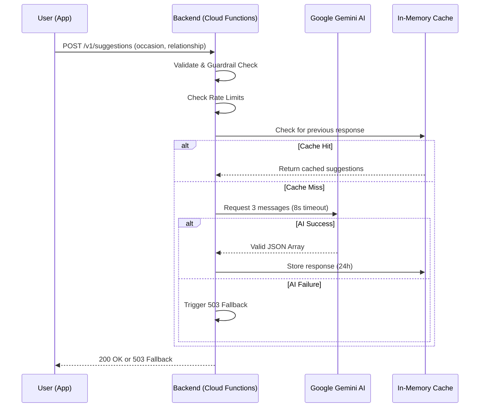

# AI Message Suggester — Technical Test

This project is a full-stack solution for an **AI-powered gift card message suggester**. It allows users to receive personalized message suggestions based on the occasion and their relationship with the recipient.

The project is structured as a monorepo containing two main submodules:

- [**API (Backend)**](api/): Node.js 24 + Firebase Cloud Functions + Google Gemini AI.
- [**App (Frontend)**](app/): Flutter 3.38+ (Dart 3.x).

---

## 🏗️ Architecture Overview

The system follows a modern, decoupled architecture:

1. **Flutter App**: Handles user interaction and displays suggestions.
2. **Firebase Cloud Functions**: Acts as a secure gateway, providing rate limiting, validation, and LLM orchestration.
3. **Google Gemini AI**: Generates personalized messages using a strictly structured prompt.



For more details, see:

- [API Architecture](api/docs/ARCHITECTURE.md)
- [App Architecture](app/docs/ARCHITECTURE.md)

---

## 🚀 Getting Started

### Quick Setup (Recommended)

We provide a script to automate environment configuration and dependency installation.

```bash
# Clone the repo with submodules
git clone --recursive git@github.com:lucssilva/message-suggester.git
cd message-suggester

# Run the setup script (requires your Gemini API Key)
./local_setup.sh --api-key YOUR_GOOGLE_GEMINI_API_KEY
```

### Manual Run

#### 1. Backend (API)

```bash
cd api
pnpm install
# Create .env with LLM_API_KEY=your_key
pnpm run serve
```

#### 2. Frontend (App)

```bash
cd app
flutter pub get
flutter run --flavor development \
  --target lib/main_development.dart \
  --dart-define=API_BASE_URL=http://localhost:5001/message-suggester/us-central1/api
```

---

## 🛠️ Decisions & Trade-offs

The project prioritizes **Resilience**, **Security**, and **Efficiency**.

- **Error Handling (503 Fallback)**: Instead of leaking LLM errors, the backend returns a friendly fallback message when the AI service is unavailable or times out.
- **In-Memory Caching (Trade-off)**: Implemented 24h caching for unique key pairs (occasion + relationship) to reduce costs and latency. For production, this would be moved to Firestore/Redis.
- **Strict Prompting**: Enforces JSON output to avoid parsing errors.
- **Regex Guardrails**: Use regular expressions at the validation layer to block prompt injection without the cost of a secondary moderation API call.

Detailed ADRs (Architecture Decision Records) can be found in the [App ADR folder](app/docs/adr/README.md).

---

## 🤖 AI Assistant Usage

This project was developed through a high-level collaboration with AI assistants (Antigravity/Gemini), following a specific **Software Design Document (SDD)** philosophy.

### Philosophy: Agent-Optimized SDD

Instead of utilizing standard, verbose documentation, we focused on **token-efficient, human-friendly docs**. This approach ensures that AI agents can quickly parse the system's "Source of Truth" without blowing through context windows, maintaining high accuracy in implementation.

### Multi-Phase Workflow

1. **Phase 1 (Foundation)**: Initial boilerplate and structural components were built using varied, high-speed models (Claude Sonnet, Gemini Flash, GLM). This phase focused on speed and standard patterns.
2. **Phase 2 (Refinement & Consistency)**: Transitioned to a "Specialized Assistant" mode. The AI was used to predict developer intent, ensure cross-submodule consistency, and identify logical gaps in the Phase 1 boilerplate that missed the developer's first review.

### Testing & Verification

AI was instrumental in:

- Generating unit tests for the backend fallback paths.
- Verifying the consistency of API contracts between the client and server.
- Maintaining clear "Agent Rules" inside submodules to guide future AI collaboration.

---
Developed by [Lucas Silva](https://github.com/lucssilva)
