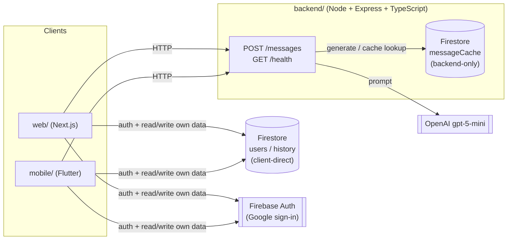

# smash-gift

An AI-powered gift card message suggester. The user describes an occasion and a relationship in free
text (e.g. "my mother's 60th birthday" / "my best friend since childhood"), and the app returns 3
message suggestions generated by an LLM (OpenAI `gpt-5-mini`), picks one, and sees it on a card.

## Scope note

The original brief for this project (a fullstack developer test) asked for a Node/TypeScript backend and
a single-screen Flutter frontend. This repository goes beyond that minimum: it also ships a Next.js web
client, Google sign-in (Firebase Auth), and a per-user generation history (Firestore) for authenticated
users — guest access (no login) remains the primary path and satisfies the core requirement on its own.
The extra surface (web app, auth, history) is additional scope the product owner chose to build, not part
of the base evaluation criteria.

## Architecture

Three independently deployable modules, coordinated by documents (no shared package/workspace between
them — each has its own `package.json`/lockfile or `pubspec.yaml`):



- **`backend/`** is the only module that talks to OpenAI. It owns prompt construction, input validation,
  rate limiting, resilience (retry, fallback, cache) and — when a request carries a Firebase ID token —
  authentication. Clients never hold OpenAI credentials.
- **`web/`** and **`mobile/`** are UI clients. Both call the backend for message generation, and — for
  authenticated users only — read/write their own Firestore documents (profile, history) directly, with
  Firestore Security Rules as the authorization boundary (see
  [`docs/contracts/firestore-schema.md`](docs/contracts/firestore-schema.md)).
- `messageCache` (used for cost reduction, see below) is only ever touched by the backend via the
  Firebase Admin SDK — clients cannot read or write it directly.

Full technical decisions per module: [`docs/specs/`](docs/specs/). HTTP contract:
[`docs/contracts/api-contracts.md`](docs/contracts/api-contracts.md). Firestore schema:
[`docs/contracts/firestore-schema.md`](docs/contracts/firestore-schema.md).

## Getting started

### Backend (`backend/`)

```bash
cd backend
npm install
cp .env.example .env   # fill in OPENAI_API_KEY at minimum
npm run dev             # http://localhost:3001
npm test                 # jest (unit + integration)
```

### Web (`web/`)

```bash
cd web
npm install
cp .env.example .env.local   # NEXT_PUBLIC_API_BASE_URL=http://localhost:3001 at minimum
npm run dev                   # http://localhost:3000
npm test                       # vitest
```

### Mobile (`mobile/`)

Flutter reads configuration via `--dart-define` (no `.env` file at runtime — see
[`mobile/.env.example`](mobile/.env.example) for the full explanation and format):

```bash
cd mobile
flutter pub get
flutter run --dart-define=API_BASE_URL=http://10.0.2.2:3001   # 10.0.2.2 = Android emulator alias for host localhost
flutter test
```

Google sign-in / Firestore require a Firebase project connected via `flutterfire configure`; if
Firebase fails to initialize (e.g. missing native config on iOS/macOS), the app falls back to the guest
flow instead of crashing.

## Key decisions

### Error handling & LLM fallback

Input validation is manual (two free-text fields, 1–300 characters each) and returns `400
VALIDATION_ERROR` with a per-field detail list. When the OpenAI call itself fails — network error,
timeout, or a response that can't be parsed into exactly 3 messages — the backend retries with a short
fixed backoff (up to 2 retries) and, if that's still unsuccessful, returns a **safe fallback**: `200` with
a fixed set of 3 generic, occasion-agnostic messages and `"fallback": true` in the response, instead of
surfacing a `5xx` to the end user. The failure is still logged server-side. Full design:
[`docs/specs/2026-08-12-backend-generation-improvements-design.md`](docs/specs/2026-08-12-backend-generation-improvements-design.md).

### Rate limiting

Fixed-window, in-memory, per-IP rate limiter on `POST /messages` (the only endpoint that costs money),
`10` requests/minute by default, both configurable via env. No persistence across restarts — a deliberate
tradeoff for a single-instance MVP; a distributed limiter (e.g. backed by Redis) would be the next step if
the backend ever runs as multiple instances.

### Cost reduction & caching

Two complementary strategies, on top of in-flight deduplication of identical concurrent requests
(already in place):

- **Output token limit + minimal reasoning effort** (`OPENAI_MAX_OUTPUT_TOKENS`, default 600, plus
  `reasoning_effort: "minimal"` on the OpenAI call): `gpt-5-mini` is a reasoning model that spends part of
  its completion-token budget on hidden reasoning tokens before producing visible output. Found via real
  manual testing that a naive token cap without `reasoning_effort` either got fully consumed by reasoning
  (empty output) or left reasoning-token usage unpredictable; `reasoning_effort: "minimal"` eliminates
  that hidden cost for this use case (short, structured output, no deep reasoning needed), which serves
  the cost-reduction goal better than a token cap alone.
- **Persistent cache** (Firestore `messageCache`, backend-only): when two requests — from any user, guest
  or authenticated — normalize to the exact same `occasion` + `relationship`, the second one reuses the
  first one's result instead of calling OpenAI again. Matching is exact-string (not semantic/embedding
  based) — simpler and free of extra API calls, at the cost of a lower hit rate on free-text input; this
  tradeoff, and why the cache isn't restricted to authenticated users, is documented in the spec linked
  above. Entries expire after `MESSAGE_CACHE_TTL_MS` (default 6h) — a deliberate bound so a repeat request
  still eventually gets a fresh generation, not an indefinitely-frozen result. Cache hits are reported to
  clients via `"cached": true` in the response, so hit/miss volume can be observed from logs.

### Testing

Jest + supertest on the backend (unit tests per validator/service/middleware, integration tests against
the full HTTP stack via `supertest`, no real network calls — OpenAI and Firestore are mocked). Vitest +
Testing Library on web. Flutter's built-in `test` package on mobile. Test structure is defined and
reviewed before implementation for every feature (test-first), not added retroactively.

## AI assistance disclosure

This project was built with [Claude Code](https://claude.com/claude-code) as the primary development
tool, using a structured process: every feature goes through a design/spec step
(`docs/specs/`), an explicit human approval gate, a test-first implementation plan, and — for backend/web/
mobile code — a dedicated sub-agent per module that only touches its own module's files. The root
`CLAUDE.md` documents this process in full, including the guardrails that keep it honest (approval
required before implementation, contract docs updated in the same task as any observable API change,
credentials never committed). All product and architecture decisions (scope, tradeoffs, what to build)
were made by the product owner in conversation with Claude Code; Claude Code generated the code, tests,
and documentation from those decisions.

## Documentation map

- [`docs/specs/`](docs/specs/) — design specs per module and per cross-cutting feature (source of truth
  for *why* something is built the way it is).
- [`docs/contracts/api-contracts.md`](docs/contracts/api-contracts.md) — HTTP contract between backend
  and clients.
- [`docs/contracts/firestore-schema.md`](docs/contracts/firestore-schema.md) — Firestore data model and
  security rules.
- [`docs/design/design-tokens.md`](docs/design/design-tokens.md) — shared visual tokens (web/mobile
  don't share UI code, so this document keeps them consistent).
- `CLAUDE.md` (root) and `backend/`, `web/`, `mobile/` `CLAUDE.md` — day-to-day conventions per module.
  These, and the specs above, are written in Portuguese (the language the product owner works in day to
  day); this README is in English since it's the entry point for external evaluators.
