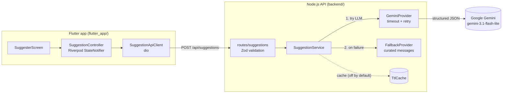

# AI-Powered Gift Card Message Suggester

Senior full-stack test solution: a small feature that uses an LLM to suggest
personalized gift card messages. You provide an **occasion** (e.g. birthday) and
a **relationship** (e.g. friend); the service returns **2–3 short message
suggestions** generated by Google **Gemini** (`gemini-3.1-flash-lite`), with a
safe, deterministic fallback when the LLM is unavailable.

- **Backend:** Node.js 20+ / TypeScript / Fastify (`backend/`)
- **Frontend:** Flutter / Dart / Riverpod (`flutter_app/`)
- **LLM:** Google Gemini `gemini-3.1-flash-lite` (structured JSON output)

> The evaluation focus of this test is **architecture, error handling, and
> documented trade-offs** — not merely "making the API call work". This README
> explains the decisions and the reasoning behind them.

---

## Repository layout

```
.
├── backend/          # Node.js + TypeScript API (Fastify + Gemini)
├── flutter_app/      # Flutter client (Riverpod + dio)
└── README.md         # this file
```

---

## Architecture

The user enters occasion + relationship in the Flutter app; the app calls the
Node.js API; the API calls Gemini and returns 2–3 suggestions. If the LLM fails,
the backend returns a **safe fallback** (HTTP 200) instead of an error.



### Backend layers (separation of concerns)

```
backend/src/
├── index.ts                       # boot + graceful shutdown
├── server.ts                      # Fastify factory, global error handler, CORS, rate-limit, /health
├── routes/suggestions.ts          # HTTP layer: validate input (Zod), map errors → status
├── services/suggestion.service.ts # orchestration: cache → LLM → fallback (never throws for LLM failures)
├── providers/
│   ├── llm.provider.ts            # LlmProvider interface (in types.ts) — decouples the service
│   ├── gemini.provider.ts         # Gemini: structured output + timeout + retry/backoff + typed errors
│   └── fallback.provider.ts       # deterministic curated messages keyed by occasion
└── lib/
    ├── config.ts                  # env parsed & validated with Zod
    ├── errors.ts                  # typed domain error hierarchy
    ├── prompt.ts                  # system instruction + prompt builder + JSON schema
    ├── security.ts                # prompt-injection defences (sanitise + output guard)
    └── cache.ts                   # in-memory LRU + TTL (opt-in)
```

The `LlmProvider` interface is the key seam: the service depends on the
interface, so Gemini can be swapped for a fake in tests, or for another provider
in production, without touching business logic.

### Frontend layers

```
flutter_app/lib/
├── main.dart
├── core/config/app_config.dart              # API_BASE_URL via --dart-define
├── data/
│   ├── models/suggestion_response.dart
│   └── suggestion_api_client.dart            # HTTP (dio) → typed Failure
├── domain/
│   ├── failure.dart                          # typed, user-facing failures
│   └── suggestion_state.dart                 # sealed: Idle | Loading | Success | Error
└── presentation/
    ├── providers/suggestion_provider.dart    # Riverpod StateNotifier
    ├── suggester_screen.dart                 # the single main screen
    └── widgets/suggestion_result_list.dart   # results + copy button + fallback banner
```

UI, API client, and state are cleanly separated: the widget layer only reads a
`SuggestionState` and never touches HTTP or error mapping. Each suggestion has a
one-tap **copy-to-clipboard** button (with a brief confirmation) so a message
can be reused immediately.

---

## API contract

### `POST /api/suggestions`

Request body:

```json
{
  "occasion": "birthday",
  "relationship": "friend"
}
```

- `occasion` (string, required)
- `relationship` (string, required)

Success `200`:

```json
{
  "suggestions": [
    "Wishing you a fantastic birthday filled with joy and laughter.",
    "Happy birthday to a truly wonderful friend.",
    "Cheers to another year of amazing memories together."
  ],
  "source": "llm"
}
```

- `source` is `"llm"` when generated by Gemini, or `"fallback"` when the
  deterministic fallback was used. The client uses this to show a subtle
  "offline suggestions" banner — the UI never breaks.

Validation error `400`:

```json
{ "error": { "code": "INVALID_INPUT", "message": "occasion is required" } }
```

Rate limited `429`:

```json
{ "error": { "code": "RATE_LIMITED", "message": "Too many requests. Please try again shortly." } }
```

### `GET /health`

```json
{ "status": "ok", "llmEnabled": true, "model": "gemini-3.1-flash-lite" }
```

Every response carries an `x-request-id` header for support/debugging
correlation; the same id is attached to server logs.

---

## Running the project

### Prerequisites

- Node.js **v20+**
- Flutter **3.38+** (Dart 3.x)
- A Google AI (Gemini) API key — <https://aistudio.google.com/apikey>
  - The free tier is enough to run this end to end.

### 1. Backend

```sh
cd backend
npm install
cp .env.example .env      # then paste your key into GEMINI_API_KEY
npm run dev               # starts on http://localhost:8080
```

`npm run dev`/`npm start` load `.env` automatically via Node's `--env-file`.

> If port 8080 is busy, set `PORT=8081` in `.env` and use that URL below.

Quick check:

```sh
curl http://localhost:8080/health
# {"status":"ok","llmEnabled":true,"model":"gemini-3.1-flash-lite"}

curl -s -X POST http://localhost:8080/api/suggestions \
  -H 'Content-Type: application/json' \
  -d '{"occasion":"birthday","relationship":"friend"}'
```

Without a key the server still boots and serves the **fallback** for every
request (`llmEnabled: false`) — useful for offline development.

### 2. Flutter app

```sh
cd flutter_app
flutter pub get
flutter run --dart-define=API_BASE_URL=http://localhost:8080
```

The base URL is configurable via `--dart-define=API_BASE_URL=...` (defaults to
`http://localhost:8080`). CORS is open by default (`CORS_ORIGIN=*`) so the app
works when run as a web target too.

The end-to-end flow **Birthday + Friend** works out of the box.

---

## Error handling and fallback

This is the heart of the design.

### What counts as a "failure"

Any of the following is treated as an LLM failure and triggers the fallback:

- **Timeout** — the Gemini call exceeds `LLM_TIMEOUT_MS` (default 8s).
- **HTTP 429** — provider rate limit / quota exceeded.
- **HTTP 5xx / network error** — provider unavailable.
- **Empty / malformed response** — output is missing or fails schema validation.
- **Safety refusal** — the model declines to answer.

### How the client is protected

- **Typed domain errors** (`LlmTimeoutError`, `LlmRateLimitError`,
  `LlmUnavailableError`, `LlmInvalidResponseError`, `InvalidInputError`) are
  mapped by a single **global error handler** to a safe `{ error: { code,
  message } }` shape. Raw errors, stack traces, and provider internals are
  **never** sent to the client — they are logged server-side with the request id.
- **Fallback returns HTTP 200**, not an error. When the LLM fails, the user
  still receives usable, curated messages, tagged `source: "fallback"`. This is
  a deliberate UX-over-REST-purity choice: for a "suggest a message" feature, a
  useful answer beats a technically-correct 5xx. The `source` field lets the
  client be transparent about it.

### Retry strategy

- **Retry only on transient failures** (429, 5xx, network, timeout), with
  **exponential backoff** (250ms → 500ms → …), up to `LLM_MAX_RETRIES` (default 2).
- **No retry on permanent failures** (e.g. a malformed prompt / 4xx) — retrying
  would just waste quota and latency.

### Robust parsing

Gemini is called with **structured output** (`responseMimeType:
application/json` + a JSON schema), so it returns strict JSON instead of prose.
As defence in depth, the output is **also** validated with a Zod schema
(2–3 non-empty messages). Anything that doesn't match is treated as a failure
and falls back.

---

## Security (prompt injection)

The user's free-text `occasion` and `relationship` go into the LLM prompt, so
the backend applies **layered prompt-injection defences**:

1. **Input sanitisation** — strip control chars and delimiter-breaking
   characters, collapse whitespace, and redact common injection phrasings
   (`ignore previous…`, `system prompt`, `reveal your prompt`, …).
2. **Structural isolation** — user values are placed in labelled, delimited
   fields (`OCCASION:` / `RELATIONSHIP:`), and the system instruction tells the
   model to treat them as untrusted *data*, never as instructions.
3. **Output guard** — model output that looks like a leaked instruction or an
   echoed injection is rejected and falls back to the curated messages.

Full write-up (threat model + each layer) in [`docs/SECURITY.md`](docs/SECURITY.md).

---

## Rate limiting

Implemented with `@fastify/rate-limit`:

- **Limit:** `RATE_LIMIT_MAX` requests (default **20**) per
  `RATE_LIMIT_WINDOW` (default **1 minute**), per IP.
- **On exceed:** HTTP **429** with a `Retry-After` header and
  `{ "error": { "code": "RATE_LIMITED" } }`.

The limit is intentionally conservative for a public demo; in production it
would be tuned per plan and enforced at the edge/gateway as well.

---

## Cost and caching

### Cost per request (measured)

Pricing for `gemini-3.1-flash-lite` (paid tier): **$0.25 / 1M input tokens**,
**$1.50 / 1M output tokens** (free tier: free).

A typical request here is ~150 input tokens (system + prompt) and ~120 output
tokens (3 short messages as JSON):

| | tokens | cost |
|---|---|---|
| Input | ~150 | ~$0.00004 |
| Output | ~120 | ~$0.00018 |
| **Total per request** | | **~$0.00022** |

So **~1M suggestions ≈ $220**, and a single request is a small fraction of a
cent. Output tokens dominate (6× the input rate), which is why the design keeps
the prompt short and caps `maxOutputTokens` at 512.

### Did I implement caching? Yes — but it is OFF by default. Here is why.

The code includes an in-memory **LRU + TTL cache** (`lib/cache.ts`), keyed by
`occasion|relationship`, that stores only successful LLM results. It is
**disabled by default** (`CACHE_TTL_MS=0`).

I made this an explicit, documented decision:

- **For a creative feature, variety is the value.** A user who clicks "generate
  again" expects *new* messages. A naive per-input cache would return the exact
  same three messages, which is a poor experience precisely when the user wants
  options.
- **The cost it would save is negligible** (~$0.0002/request), so there is no
  real cost pressure to trade UX against.
- The mechanism is kept (and unit-tested) because it is the right tool when the
  usage profile is different — e.g. many *distinct* users hitting the same
  popular combination, where a given user rarely sees a repeat.

### How I would reduce cost in production

1. **Cheapest suitable model + tight prompts.** Already done: Flash-Lite,
   concise system instruction, low `maxOutputTokens`.
2. **Pool + rotation cache (instead of naive per-input cache).** Cache a *larger
   pool* (e.g. 9 messages) per key and serve a rotating slice of 3 per request.
   This gives variety **and** amortizes one LLM call across several requests
   (~66% fewer calls for "generate again"), refilling/reshuffling when the pool
   is exhausted. Not implemented here because the extra state (cursor, exhaustion
   handling, concurrency) adds complexity that the negligible cost does not
   justify for this scope.
3. **Shared cache store (Redis).** The current cache is per-process; horizontally
   scaled instances would each have their own. Redis would share it across
   instances and survive restarts.
4. **Batch API** for any offline/bulk generation (50% cheaper).

---

## Testing

### Backend (Vitest)

```sh
cd backend
npm test
```

Covers (33 tests):

- **Fallback path** — LLM provider throws → response is `source: "fallback"`,
  HTTP 200, non-empty messages (**the required test**).
- **Fallback-only mode** — no LLM configured → fallback.
- **Happy path** — mocked provider returns valid suggestions → `source: "llm"`.
- **Cache** — hit within TTL, expiry, LRU eviction, disabled when TTL = 0.
- **Gemini provider** — retry on transient (5xx/429/network), no retry on
  malformed/empty output, error classification, and the output-safety guard.
- **Prompt injection** — sanitisation, redaction, delimiter stripping, and the
  output guard's accept/reject decisions.
- **Input validation** — invalid body → 400 `INVALID_INPUT`.
- **No error leakage** — a provider error message never reaches the client.
- **Rate limiting** — exceeding the limit → 429 `RATE_LIMITED`.
- **Health** — `GET /health` → 200.

### Frontend (Flutter)

```sh
cd flutter_app
flutter test
```

Widget tests for the main screen using a Riverpod-overridden fake API client:

- loading → **success** renders the suggestions,
- loading → **error** shows the message + a "Try again" button,
- empty inputs are **validated** before a request is made,
- tapping **copy** puts a suggestion on the clipboard and confirms it.

### Quality gates

- Backend: `npm run lint` (ESLint + `@typescript-eslint`), `npm run typecheck`
  (TypeScript `strict`), `npm run build`.
- Frontend: `flutter analyze` (very_good_analysis, clean).

---

## Configuration reference (backend `.env`)

| Variable | Default | Description |
|---|---|---|
| `GEMINI_API_KEY` | — | Google AI key. If empty, fallback-only mode. |
| `GEMINI_MODEL` | `gemini-3.1-flash-lite` | Model id (swappable). |
| `PORT` / `HOST` | `8080` / `0.0.0.0` | HTTP server. |
| `LLM_TIMEOUT_MS` | `8000` | Per-call timeout before fallback. |
| `LLM_MAX_RETRIES` | `2` | Retries on transient LLM errors. |
| `RATE_LIMIT_MAX` | `20` | Requests per window per IP. |
| `RATE_LIMIT_WINDOW` | `1 minute` | Rate-limit window. |
| `CACHE_TTL_MS` | `0` | Cache TTL; `0` disables (see Cost and caching). |
| `CORS_ORIGIN` | `*` | Allowed origins (comma-separated or `*`). |
| `LOG_LEVEL` | `info` | Pino log level. |

---

## Use of AI assistance (transparency)

Per the test's transparency requirement: I built this with the help of an AI
coding assistant, and I want to be clear about how.

- **What I decided and directed:** the overall architecture (layered backend
  with an `LlmProvider` seam; Riverpod + sealed-state frontend), the choice of
  Gemini `gemini-3.1-flash-lite`, the API contract, the resilience strategy
  (typed errors, retry-only-on-transient, HTTP-200 fallback with a `source`
  flag), and — notably — the **cache decision**. I explicitly evaluated a
  pool+rotation cache, checked the real per-request cost, and decided to ship the
  cache **disabled by default** and document the reasoning rather than
  over-engineer it. Those are my engineering judgments.
- **What the AI helped implement:** scaffolding the files, writing boilerplate
  (config parsing, DTOs, widgets), drafting tests, confirming the current
  `@google/genai` SDK surface and Gemini pricing, and iterating on lint/type
  fixes.
- **Verification:** I ran the backend against the real Gemini API (validating
  `source: "llm"` and `400` on invalid input) and ran the full backend and
  Flutter test suites. Nothing was accepted on trust without the build, types,
  lint, and tests passing.
```
