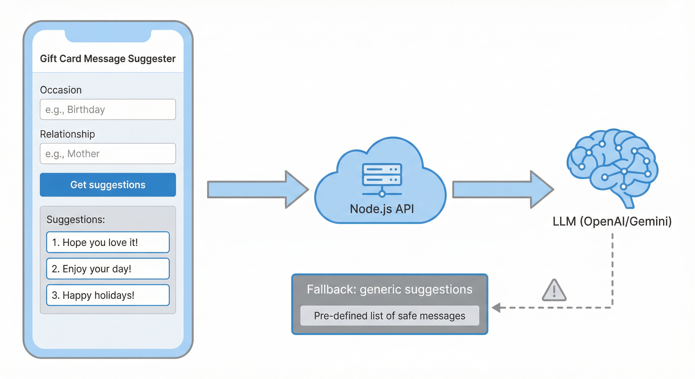

# Gift Notes — AI gift-card message suggester

Solução para o [teste full-stack da Smash](https://github.com/smash-gift/fullstack-dev-test). O projeto contém uma API TypeScript/Node.js e um app Flutter que gera mensagens curtas e personalizadas para cartões-presente usando o Google Gemini.



## Arquitetura

```text
Flutter app
  └─ SuggestionsApiClient (HTTP, base URL configurável)
       └─ POST /api/suggestions
            └─ validação + rate limit
                 └─ SuggestionService
                      ├─ Gemini API (@google/genai, JSON estruturado)
                      └─ fallback determinístico seguro
```

A chave do Gemini fica exclusivamente no backend. O Flutter conhece somente a URL da API e nunca recebe ou envia a chave do provedor.

## Estrutura

```text
backend/
  src/
    app.ts                    # Fastify, headers, CORS, rota e rate limit
    suggestion-service.ts     # Orquestra Gemini e fallback
    llm/gemini-client.ts      # Integração Gemini + schema JSON + validação Zod
    fallback.ts               # Mensagens determinísticas seguras
    validation.ts             # Validação do contrato de entrada
  tests/                      # Testes HTTP e de serviço
flutter_app/
  lib/
    data/                     # Cliente HTTP e erros de API
    models/                   # Modelo da resposta
    presentation/             # Controller e tela
  test/                       # Testes de widget
```

Firebase não foi adicionado porque autenticação, persistência e Firestore não são necessários para os critérios de aceitação deste teste. As fronteiras entre API, estado e UI permitem adicionar esses recursos depois sem acoplá-los à tela.

## Requisitos

- Node.js 20+
- Flutter 3.38+ / Dart 3+
- Uma chave da [Google AI Studio](https://aistudio.google.com/apikey)

O backend usa `@google/genai` e o modelo configurável `gemini-flash-lite-latest` por padrão, uma opção leve para desenvolvimento e free tier. O free tier do Gemini pode impor limites de requisições por projeto/modelo; consulte os [preços](https://ai.google.dev/gemini-api/docs/pricing) e [limites atuais](https://ai.google.dev/gemini-api/docs/rate-limits).

## Como executar o backend

```bash
cd backend
npm install
cp .env.example .env
```

Preencha `.env`:

```dotenv
GEMINI_API_KEY=sua_chave_do_google_ai_studio
GEMINI_MODEL=gemini-flash-lite-latest
GEMINI_TIMEOUT_MS=8000
RATE_LIMIT_MAX=30
RATE_LIMIT_WINDOW=1 minute
```

Inicie a API:

```bash
npm run dev
```

O servidor escuta em `http://localhost:3000`.

### Contrato da API

`POST /api/suggestions`

Request:

```json
{
  "occasion": "aniversário",
  "relationship": "melhor amiga"
}
```

Resposta quando o Gemini funciona:

```json
{
  "suggestions": ["Mensagem 1", "Mensagem 2", "Mensagem 3"],
  "source": "llm",
  "fallback": false
}
```

Quando o Gemini não está configurado, expira, retorna erro (incluindo 429/5xx), resposta vazia ou JSON inválido, a API devolve HTTP 200 com três mensagens determinísticas e `fallback: true`. Assim o fluxo continua útil sem vazar detalhes do provedor ou stack trace.

`GET /health` retorna `{ "status": "ok" }`.

## Como executar o Flutter

```bash
cd flutter_app
flutter pub get
flutter run --dart-define=API_BASE_URL=http://127.0.0.1:3000/
```

Para um emulador Android, use o loopback do host:

```bash
flutter run --dart-define=API_BASE_URL=http://10.0.2.2:3000/
```

Em um dispositivo físico, substitua o host pelo IP local do computador e mantenha os dois dispositivos na mesma rede.

A tela oferece campos digitáveis e atalhos de escolha rápida. Os estados tratados são: inicial, carregando, sucesso com Gemini, sucesso com fallback/offline, validação local, erro de backend, limite excedido, timeout, falha de conexão e resposta inválida. Cada sugestão pode ser copiada.

O shell mobile permite rede cleartext/local apenas para o desenvolvimento com `http://localhost`/`10.0.2.2`. Em produção, use HTTPS e remova essa permissão de desenvolvimento.

## Testes e verificações

Backend:

```bash
cd backend
npm test
npm run test:live
npm run typecheck
npm run build
```

`npm test` é determinístico e não chama a internet. `npm run test:live` é o teste de contrato da IA: usa a chave configurada no `.env`, chama o Gemini real e valida 2–3 sugestões distintas, não vazias e com até 240 caracteres. Ele deve ser executado conscientemente porque consome uma chamada da quota e pode falhar por indisponibilidade ou limite do provedor.

Flutter:

```bash
cd flutter_app
flutter test
flutter analyze
```

Os testes do backend cobrem health check, JSON malformado, request inválido sem chamar o provedor, fallback sem chave, fallback quando o LLM falha, parsing/validação da resposta Gemini, sucesso do serviço e rate limiting. O teste unitário do adaptador simula o SDK para validar o schema sem custo; o teste live valida o contrato do Gemini real sem fixar frases específicas. Os testes Flutter cobrem renderização de sugestões, erro amigável do backend e feedback de campos vazios.

Para validar a integração real localmente, com a chave preenchida em `backend/.env`:

```bash
cd backend
npm run dev
curl -s http://localhost:3000/api/suggestions \
  -H 'content-type: application/json' \
  -d '{"occasion":"aniversário","relationship":"melhor amiga"}'
```

O resultado esperado para uma chamada real tem `source: "llm"` e `fallback: false`. Se a quota estiver esgotada ou o serviço estiver indisponível, o contrato continua funcionando com `source: "fallback"`.

### Validação realizada nesta entrega

- Backend: 4 arquivos de teste, 10 testes determinísticos aprovados; typecheck e build aprovados.
- IA: 3 testes unitários do adaptador Gemini e 1 teste live de contrato executado com sucesso contra o modelo real.
- Flutter: 3 widget tests aprovados; `flutter analyze` sem problemas.
- Integração real: chamada local ao Gemini retornou `source: "llm"` e `fallback: false`.
- Simulador iPhone 16 Pro: fluxo de preenchimento e geração exibiu mensagens reais do Gemini na tela.

## Matriz de requisitos do teste

| Requisito do enunciado | Implementação/documentação |
| --- | --- |
| Backend Node.js/TypeScript | `backend/src/app.ts`, `backend/src/server.ts` e `backend/src/llm/gemini-client.ts` |
| Entrada `occasion` e `relationship` | `backend/src/validation.ts` e `POST /api/suggestions` |
| 2–3 sugestões curtas via LLM | schema Gemini em `backend/src/llm/gemini-client.ts` + `SuggestionResponse` |
| Falha do LLM sem erro cru para o cliente | `backend/src/suggestion-service.ts`, `backend/src/fallback.ts` e seção “Erros e fallback” abaixo |
| Tela Flutter com entrada, ação e resultados | `flutter_app/lib/presentation/suggestion_page.dart` |
| Loading, sucesso e erro | `flutter_app/lib/presentation/suggestion_controller.dart` e `suggestion_page.dart` |
| App chamando o backend com URL configurável | `flutter_app/lib/data/suggestions_api.dart` e `--dart-define=API_BASE_URL` |
| Separação UI/API/estado | `flutter_app/lib/presentation`, `lib/data` e `lib/models` |
| Teste de fallback | `backend/tests/suggestion-service.test.ts` e `backend/tests/app.test.ts` |
| Como executar e decisões | Este README, especialmente “Como executar”, “Testes”, “Decisões” e esta matriz |

## Decisões e trade-offs

### Erros e fallback

O backend valida a entrada antes de invocar o Gemini. Erros do provedor, timeout, resposta vazia, JSON inválido e schema inválido são convertidos em um evento de log categorizado e em mensagens de fallback. O cliente recebe sempre um formato estável, sem detalhes internos ou stack traces.

### Timeout

A chamada Gemini é cancelada após `GEMINI_TIMEOUT_MS` — 8 segundos por padrão — usando `AbortController`, e o serviço devolve o fallback sem expor o erro ao cliente.

### Rate limiting

A API permite 30 requisições por minuto por IP por padrão. Ao exceder o limite, retorna HTTP 429 com uma mensagem segura. Em produção, o limite deve usar um armazenamento compartilhado como Redis quando houver múltiplas instâncias.

### Custo e cache

Este teste não implementa cache porque o espaço de entradas é aberto e o tráfego esperado é pequeno. Em produção, eu normalizaria `(occasion, relationship)`, aplicaria cache de respostas bem-sucedidas com TTL curto, limitaria tokens de entrada/saída, manteria um modelo Flash de baixo custo e mediria o hit rate. Também adicionaria request ID e métricas de uso antes de operar em escala.

### Prompt e segurança da saída

O Gemini recebe instruções para produzir JSON estruturado com 2–3 mensagens. A resposta é validada com schema do Gemini e Zod antes de ser retornada. A API key é carregada somente por variável de ambiente e `.env` não deve ser commitado ou incluído no ZIP de entrega.

## Transparência sobre uso de IA

Codex foi usado para implementar o backend, a integração Gemini, o app Flutter, os testes e esta documentação. As decisões finais estão explicitadas neste README: escolha do Gemini, formato JSON estruturado, fronteira entre serviço/fallback, timeout, ;rate limit, URL configurável, tratamento de estados e decisão de não adicionar Firebase por não ser exigido pelos critérios.
