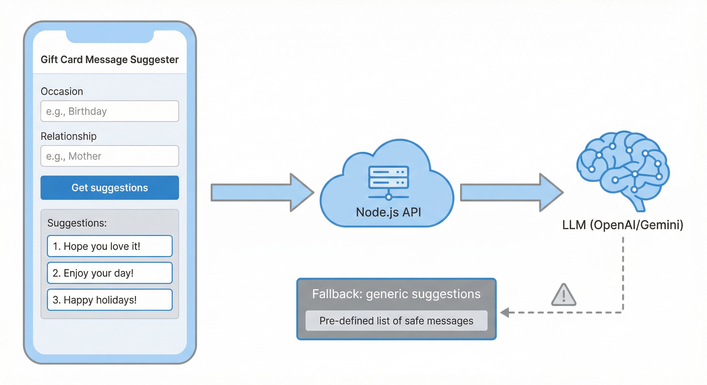

# Technical Test — Full Stack Developer AI-First

**Role:** Full Stack Developer AI-First  
**Estimated time:** 4–6 hours  
**Stack:** TypeScript/Node.js, Next.js (App Router)/React, Firebase (Firestore, Cloud Functions, Auth)

---

## About this test

This test evaluates your ability to design and implement a small feature that uses an **LLM (Large Language Model)** to suggest personalized gift card messages. We are interested in your architectural choices, error handling, and how you document trade-offs—not only in “making the API call work.” You will build a **backend service** and a **Next.js web app** that consumes it.

---

## Objective

Build an **AI-powered gift card message suggester**:

1. **Backend (Node.js/TypeScript):** An API that receives **occasion** (e.g. birthday, wedding, thank you) and **relationship** (e.g. friend, colleague, parent) and returns **2–3 short message suggestions** (e.g. 1–2 sentences each) generated by an LLM.
2. **Frontend (Next.js/React/TypeScript):** A simple page where the user can choose or type occasion and relationship, request suggestions, and see the results (with loading and error states).

You must also handle **failure of the LLM API** (e.g. timeout, 429, 5xx) with a clear fallback and document your decisions.

### Overview

The diagram below summarizes the flow: the user enters occasion and relationship in the Next.js app; the app calls your Node.js API; the API calls the LLM and returns 2–3 suggestions. When the LLM fails, the backend should return a safe fallback instead of an error stack.

---

## Prerequisites

- **Node.js** v20+
- **LLM API access:** OpenAI API key **or** Google AI (Vertex AI / Gemini) API key—you choose one. Use a single model (e.g. GPT-4o-mini, or Gemini Flash) to keep cost and latency reasonable.
- **Git** and a **GitHub** account

---

## Detailed requirements

### 1. Backend (Node.js / TypeScript)

- **Separate service**
  - Build the backend as its own service (e.g. Express, Fastify or a Firebase Cloud Function), not inside the Next.js app.
- **API contract**
  - Input: `occasion` and `relationship`. Output: 2–3 short message suggestions suitable for a gift card. You choose the HTTP method, request/response format, and document it.
- **LLM integration**
  - Call one LLM provider (OpenAI or Google AI). How you structure the prompt and handle the model output is up to you. The LLM API key must never reach the browser.
- **Error handling and fallback**
  - When the LLM API fails, the backend must not expose raw errors to the client. Document in your README what you consider a failure, how you respond to the client, and why.
- **Rate limiting (optional)**
  - If you implement it, document the limit and the behavior when it is exceeded.
- **Cost and caching**
  - In your README, describe how you would reduce cost in production and whether you implemented any caching in this test (and why or why not).

### 2. Frontend (Next.js / React / TypeScript)

- One main page, built with the **App Router**: inputs for occasion and relationship, a way to request suggestions, and display of the results. At least one flow (e.g. Birthday + Friend) must work end-to-end.
- Handle loading, success, and error states so the user always has clear feedback.
- The page must be usable on a mobile viewport.
- The app must call your backend; the base URL should be configurable. Whether the browser calls the backend directly or through Next.js (a Route Handler or a Server Action) is your choice—explain it in your README. Your README must also explain how to run backend and app and which URL to use.
- Organize the project so that UI, API client, and state are clearly separated. We expect readable, maintainable code.
- Styling is up to you. Our stack is Tailwind + shadcn/ui, but it is not required.

### 3. Documentation (in your fork's README)

Your fork's README must include: how to run the project (backend and app), a short description of the architecture (a diagram is encouraged), your decisions and trade-offs (errors, rate limiting, cost/caching), and—if you used an AI assistant—how you used it and what you implemented or decided yourself.

### 4. Tests (optional but valued)

- **Backend:** at least one test that covers the fallback path when the LLM fails. More tests (happy path, rate limiting) are a plus.
- **Frontend:** component tests for the main page (e.g. Vitest + Testing Library) or an end-to-end test of the main flow (e.g. Playwright) are a plus.

---

## How to run this test

1. **Fork** this repository to your own GitHub account.
2. **Clone** your fork locally.
3. **Create a branch** (e.g. `candidate/jane-doe` or `solution/fullstack-test`).
4. **Implement** the backend and the Next.js app according to the requirements above. You can place them in two folders at the root of your fork (e.g. `backend/` and `web/`), or in a structure you prefer—document it in the README.
5. **Document** everything in your fork’s README as specified in the “Documentation” section.
6. **Open a Pull Request** from your branch to the **original repository’s `main`** (or `master`) branch. The PR description can be short (e.g. “Full stack dev test – AI message suggester”); we will use the PR and the code in your fork for evaluation.

If the original repo does not allow PRs from forks, send the link to your **fork** (with the branch) instead, and we will review the code there.

---

## What we evaluate

- **Correctness:** Does the flow work end-to-end (inputs → backend → LLM → suggestions → displayed in the Next.js app)?
- **Error handling:** Graceful handling of LLM failures and clear, safe responses.
- **Code quality:** Readable, structured code; sensible naming and separation of concerns.
- **Documentation:** Clear run instructions, architecture, and explained trade-offs.
- **Design:** Reasonable API design, prompt design, and user feedback (loading/error/success).
- **Transparency:** Clear description of how you used AI tools during the test.

We do **not** require a deployed URL; local run instructions are enough.

---

## Issues and questions

If anything is unclear, open an **Issue** in this repository and we will reply as soon as possible. Please do not fork and submit a solution before clarifying critical doubts.

Good luck.
