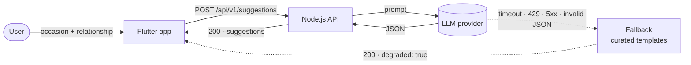
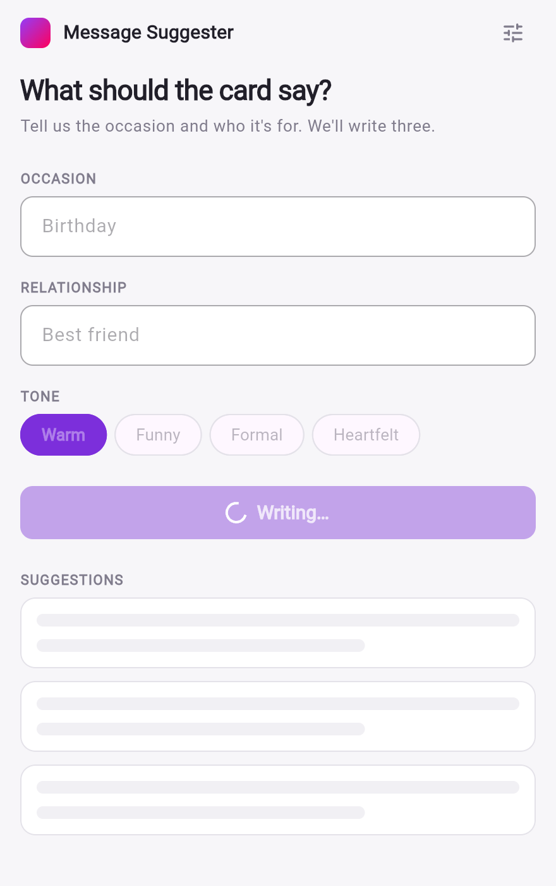
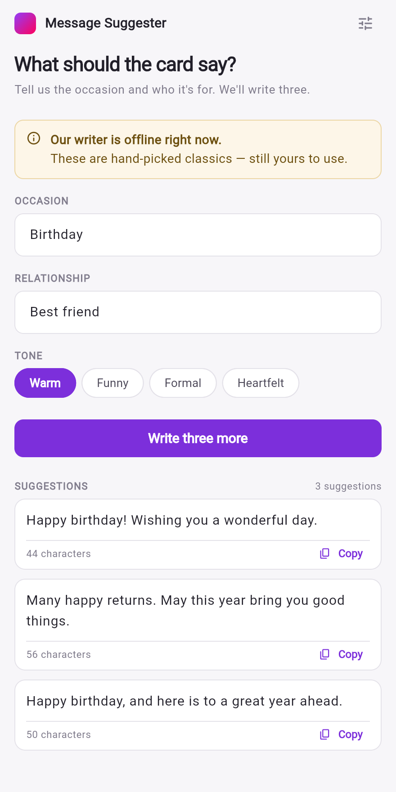
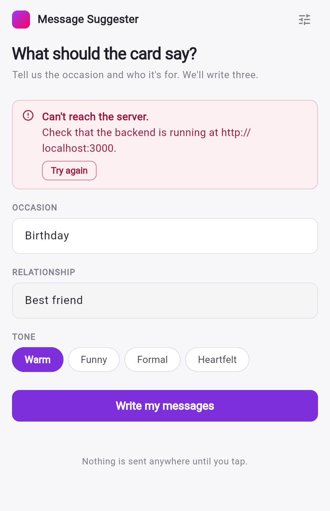
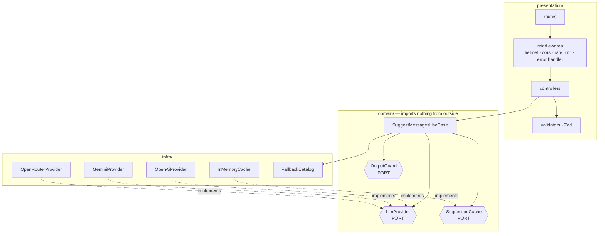

# AI Gift Card Message Suggester

A Node.js/TypeScript API that asks an LLM for short gift card messages, and a Flutter app
that renders them.

Calling an LLM is the easy half. The half this test measures is the dashed line:



**The user never gets an error screen.** When the model fails, the API still answers `200`
with usable messages and a flag saying quality dropped.

[Quick start](#quick-start) · [No API key](#no-api-key-no-problem) · [Which URL](#which-url-to-use) ·
[Architecture](#architecture) · [API](#api) · [Fallback](#error-handling-and-the-fallback) ·
[Rate limiting](#rate-limiting) · [Cost and caching](#cost-and-caching) · [Security](#security) ·
[Tests](#tests) · [Decisions](#decisions-and-trade-offs) · [How I used AI](#how-i-used-ai)

---

## The five states, from the running app

Captured from the Flutter web build driving the real API. The degraded shot is a real
failure: the same backend restarted with a deliberately invalid key.

| Idle | Loading | Success — from the LLM |
|---|---|---|
|  |  |  |

| Degraded — the LLM failed, `200` anyway | Error — the backend is unreachable |
|---|---|
|  |  |

The two failures look different on purpose. **The LLM failing is not an error for the
user** — three messages to copy, under an amber note. Red is reserved for a failure that
leaves nothing to show.

---

## Quick start

Two terminals, one API key, no build step in between. **No key?**
[The whole stack runs without one.](#no-api-key-no-problem)

### 1. Backend

```bash
cd backend
npm install
cp .env.example .env
```

Open `.env` and set the key for your provider (`openai` is the default):

```env
LLM_PROVIDER=openai
OPENAI_API_KEY=sk-...
```

```bash
npm run dev
```

A missing key stops the server at boot instead of failing on the first request. Check it:

```bash
curl -sS http://localhost:3000/health
# {"status":"ok","uptimeSeconds":5,"version":"1.0.0","llmProvider":"openai"}
```

Interactive API docs: **http://localhost:3000/docs** — Swagger UI, generated from the same
Zod schemas that validate the requests.

### 2. Flutter app

In a second terminal, with the backend running:

```bash
cd flutter_app
flutter pub get
flutter run -d chrome
```

Type **Birthday** and **Best friend**, tap *Write my messages*.

### No API key? No problem

The reviewer's path with zero credentials, in a `.env` of one line:

```bash
cd backend
npm install
echo 'LLM_PROVIDER=stub' > .env
npm run dev
```

Everything runs end to end — validation, cache, rate limiting, the app and its screens —
with a deterministic in-process provider standing in for the model. The response says which
path ran: `"model": "stub-deterministic-v1"`.

The stub *succeeds*, so it is not the fallback either; `degraded` stays `false`. To watch
the real degradation without a key, see [the fallback in ten seconds](#see-it-degrade).

### Which URL to use

The app ships with a per-platform default, so `flutter run` normally needs no argument:

| Where the app runs | Base URL | Why |
|---|---|---|
| Chrome / desktop browser | `http://localhost:3000` | same machine |
| iOS Simulator | `http://localhost:3000` | shares the host network |
| **Android emulator** | `http://10.0.2.2:3000` | `localhost` inside the emulator is the emulator |
| Physical device | `http://<your-lan-ip>:3000` | same Wi-Fi; `ipconfig getifaddr en0` |

Override it at build time, which is what a deployment would do:

```bash
flutter run --dart-define=API_BASE_URL=https://api.example.com
```

Or change it **while the app is running**, from the control at the top right. The address is
resolved per request rather than captured at startup, so an installed build can be pointed
at another backend without recompiling.

### Prerequisites

| Tool | Minimum | Verified here |
|---|---|---|
| Node.js · npm | 20 · 10 | `v20.19.6` · `10.8.2` |
| Flutter · Dart | 3.38 · 3.x | `3.44.2` · `3.12.2` |
| LLM API key | optional | OpenAI (default), Google AI or OpenRouter |

Firebase is **not** required to run this — [see below](#why-firebase-is-not-in-the-runtime).

---

## Architecture

`backend/` (Node.js 20 + TypeScript) and `flutter_app/` (Flutter) share one shape:
**the business rule sits in the middle and depends on nothing.** Everything replaceable —
HTTP framework, LLM client, cache, the app's HTTP driver — sits behind an interface the
domain owns.



Two consequences, both load-bearing. **707 backend tests and 95 Flutter tests run with no
network and no API key**, because the providers are swapped for doubles at the port — that
is what makes "the reviewer can run the tests" true. And **the fallback lives in the use
case** rather than in an adapter, so every provider inherits the same failure behaviour
while switching provider stays one environment variable.

The layering is **enforced**, not just documented: 20 tests in the backend and 22 in the app
fail the build when a dependency arrow points the wrong way, a page declares a widget,
`process.env` is read outside the config file, or a `catch` block is left empty. Each rule
was checked by planting a violation and watching it fail.

The app follows Clean Dart (`external → infra → domain ← presenter`) with `ChangeNotifier`
for state and manual DI in a 15-line composition root.

Details: [backend](docs/01-architecture/backend.md) ·
[frontend](docs/01-architecture/frontend.md) ·
[overview with diagrams](docs/01-architecture/overview.md)

---

## API

One endpoint. Every field and status: [`docs/03-api/contract.md`](docs/03-api/contract.md),
or the live Swagger UI at `/docs`.

```http
POST /api/v1/suggestions
Content-Type: application/json

{ "occasion": "birthday", "relationship": "friend" }
```

| Field | Required | Rules | Default |
|---|---|---|---|
| `occasion` | ✅ | 2–60 characters | — |
| `relationship` | ✅ | 2–60 characters | — |
| `tone` | ❌ | `warm` · `funny` · `formal` · `heartfelt` | `warm` |
| `language` | ❌ | `en` · `pt` · `es` | `en` |
| `count` | ❌ | `2` or `3` | `3` |

**`200`** — a real response from `gpt-4o-mini`:

```jsonc
{
  "data": {
    "suggestions": [
      { "id": "sug_5e4f0e0aa5f127f3", "text": "Happy birthday to an amazing friend! Wishing you a day filled with joy and laughter." },
      { "id": "sug_73290c2a41151e77", "text": "Cheers to another year of friendship! May your birthday be as wonderful as you are." },
      { "id": "sug_84a7e991dddb1581", "text": "On your special day, I hope all your dreams come true. Enjoy every moment!" }
    ],
    "source": "llm", "model": "gpt-4o-mini", "degraded": false
  },
  "meta": { "requestId": "req_27cf0e16197a22b7", "generatedAt": "2026-09-03T23:30:58.453Z", "cached": false }
}
```

**`200` when the LLM failed** — same shape, three curated messages, and the client is told:

```jsonc
{
  "data": { "suggestions": [ /* three of them */ ], "source": "fallback", "model": null, "degraded": true },
  "meta": { "requestId": "req_77be4fc5a52445a8", "cached": false, "reason": "llm_auth_error" }
}
```

Errors use one envelope with stable codes and never a stack trace:

```jsonc
{
  "error": {
    "code": "VALIDATION_ERROR",
    "message": "Invalid request body",
    "details": [{ "field": "occasion", "issue": "occasion must be at least 2 characters" }]
  },
  "meta": { "requestId": "req_4488b5dcce03dae0", "timestamp": "2026-09-03T23:30:58.473Z" }
}
```

| Status | Code | When |
|---|---|---|
| `200` | — | Success, from the LLM **or** the fallback |
| `400` | `VALIDATION_ERROR` | Body failed validation |
| `405` · `404` | `METHOD_NOT_ALLOWED` · `NOT_FOUND` | Wrong verb · no such route |
| `413` · `415` | `PAYLOAD_TOO_LARGE` · `UNSUPPORTED_MEDIA_TYPE` | Body over 4 KB · not JSON |
| `429` | `RATE_LIMITED` | Rate limit exceeded, with `retryAfterSeconds` |
| `500` | `INTERNAL_ERROR` | Anything unforeseen; generic message, detail goes to the log |

---

## Error handling and the fallback

### What counts as a failure

| Situation | Reason code |
|---|---|
| Provider did not answer within `LLM_TIMEOUT_MS` (8s) | `llm_timeout` |
| Provider answered `429` | `llm_rate_limited` |
| Provider answered `5xx`, or the network failed | `llm_unavailable` |
| Provider answered `200` with a body that fails validation | `llm_invalid_response` |
| API key missing, invalid or out of credit | `llm_auth_error` |

The fourth matters more than it looks. **A `200` from the provider is not a success.** The
body is parsed against a schema, and a well-formed response carrying the wrong shape, the
wrong number of suggestions, or text that fails the output guard is a failure like any
other.

Whatever happened, the client gets the same thing: `200`, three usable messages from a
curated catalogue, `degraded: true`, and a stable `reason`. Never a stack trace, never a
provider name, never a partial answer.

### Why `200` and not `503`

Because the request succeeded. The client asked for gift card messages and is getting gift
card messages, from a lower-quality source, which is what `degraded` announces. A `5xx`
would mean "I could not serve you", and the app would then need a second success path to
render a body it was told to treat as an error.

The cost of that choice: a caller who ignores `degraded` cannot tell the difference. That is
why the flag sits inside `data` rather than in a header — you walk past it to reach the
suggestions. Alternatives considered and rejected (`503`, `203`, an empty `200`) are in
[ADR-0003](docs/01-architecture/decisions/adr-0003-fallback-strategy.md).

### Retries

One retry, only for `5xx` and network errors, sharing the total timeout budget instead of
multiplying it. Retrying a `429` adds load to a provider that just said it is overloaded;
retrying a `401` fails identically, slower. Disable with `LLM_MAX_RETRIES=0`.

### See it degrade

Ten seconds by hand, on a machine that never had a valid key:

```bash
cd backend
LLM_PROVIDER=openai OPENAI_API_KEY=sk-invalid-on-purpose LLM_MAX_RETRIES=0 npm run dev
```

Every request now returns `200`, `degraded: true`, `reason: "llm_auth_error"`, and the app
shows the amber screenshot above. The same five failure modes are covered by
`backend/tests/integration/fallback.route.test.ts`, at the HTTP boundary, in 39 cases.

---

## Rate limiting

Implemented: **30 requests per 5 minutes per IP** on `/api/v1/*`, answered with `429`,
`RATE_LIMITED`, `Retry-After` and standard headers:

```
RateLimit-Policy: 30;w=300     RateLimit-Remaining: 0     Retry-After: 293
```

Its real job here is cost: every request that misses the cache spends tokens, and thirty in
five minutes leaves roughly six times the headroom a person needs while capping what an
abusive loop can spend.

Two ordering decisions do most of the work, both pinned by tests. **CORS runs before the
limiter**, so a `429` reaches the browser instead of surfacing as an opaque CORS failure,
and preflights never spend quota. **The limiter runs before the body parser**, so a blocked
request never reaches the model.

`TRUST_PROXY_HOPS` is a hop **count**, never `true`: trusting the whole `X-Forwarded-For`
chain would let a caller forge a new identity per request and walk through the limit.
[ADR-0005](docs/01-architecture/decisions/adr-0005-rate-limiting.md).

---

## Cost and caching

### Did I implement caching in this test?

**Yes** — an in-memory LRU behind a domain port.

| Key | TTL | Capacity | Off switch |
|---|---|---|---|
| `sha1` of provider · model · occasion · relationship · tone · language · count | 10 min | 500 entries | `CACHE_ENABLED=false` |

The input space invites it: `occasion × relationship` is small and heavily repeated.
`model` belongs in the key, or switching provider would keep serving the old one's results
for ten minutes.

**Fallback responses are never cached** — caching a degradation freezes the system's worst
moment. **What the cache costs:** two users asking for "birthday + friend" in the same
window get *exactly* the same three messages, which is bad for a product selling
personalization; the fix is the first lever below. The port is `async` although the
implementation is not, so swapping in Redis is a new file rather than a signature change
that propagates `await` through every caller.

### What a request costs

Measured against the real API with the exact body the adapter sends: **426–428 input tokens**
(a constant; it moves by a token or two because the injection canary changes per process)
and **44–68 output tokens**. At `gpt-4o-mini` list prices, **≈ US$ 0.0001 per uncached
request**.

Worth isolating: replacing the hardened system prompt with a one-line one drops the input
from 428 to **79** tokens. **The prompt hardening costs 349 input tokens, about US$ 0.00005
per request** — half the unit cost of the product, and still the cheapest control in this
repository.

### How I would reduce cost in production

Ordered by impact over effort:

| # | Lever | Effect |
|---|---|---|
| 1 | **Cache a pool, not a result** — 10–15 per key, TTL in hours, draw 3 | Biggest lever by a distance, and it gives the variety back |
| 2 | **Precompute the short tail** in a nightly batch | ~50 combinations likely cover 80% of traffic: cost moves from per request to per day |
| 3 | **Size the model to the job** | Two sentences on a card need no frontier reasoning — [measured below](#which-provider-and-why-measured) |
| 4 | **Short prompt, capped output** | Input tokens are billed and prompts grow by accretion |
| 5 | **Provider prompt caching** | A fixed system prompt at volume discounts repeated input. Configuration, not architecture |
| 6 | **Batch the asynchronous work** | About half price for more latency: ideal for (2), useless interactively |
| 7 | **Budget and alerting** | Does not lower unit cost; prevents the invoice incident, usually the bigger damage |
| 8 | **Rate limiting** | Already implemented, above |

Token counts are measurements; the dollars are list price on the day this was written. What
I would defend in six months is the ordering, not a "$X per 1000 requests" headline. Full
reasoning: [ADR-0006](docs/01-architecture/decisions/adr-0006-caching-and-cost.md).

---

## Security

Not asked for by the brief. It is here because the endpoint takes free text from a user and
feeds it to a model.

The property the design turns on:

> **This system's LLM has no tools.** No function calling, no database, no file access, no
> outbound requests. A prompt injection here cannot execute code or exfiltrate data. It can
> do one thing: make the model emit text that we then display as our own product.

That settles where the weight goes. Nobody can guarantee blocking every injection at the
input; **validating what comes out before displaying it is a guarantee.**

| # | Layer | What it does |
|---|---|---|
| 1 | Input sanitization | NFKC normalization; rejects bidi overrides, zero-width and control characters, newlines; character allowlist; injection heuristics |
| 2 | Prompt structure | The system prompt is a constant, never interpolated with user text. Input travels as a JSON value, with spotlighting and a per-process canary |
| 3 | **Output validation** ⭐ | Rejects URLs, e-mails, HTML, markdown links, code fences, the canary, meta-responses. Any rejection → fallback |
| 4 | Safe rendering | Suggestions render as plain `Text`. No HTML/Markdown widget, no linkify, no tappable ancestor |

**A blocked injection is indistinguishable from a provider timeout**, reusing the same
`200 · degraded: true` funnel. An attacker learns nothing about which rule fired, and no
second degradation mechanism was needed.

**The tests assume the model is fully compromised.** A 38-payload corpus runs through a
provider that echoes the input back with a URL and the canary, asserting that layer 3 holds
alone. Alongside it, 12 *legitimate* inputs (`aniversário`, `結婚式`, `عيد ميلاد`,
`Mother's Day` with a typographic apostrophe), because a defence that strangles the product
is not a defence.

A gated live suite fires the same corpus at the real model, and its
[report](docs/05-security/live-redteam-report.md) records the useful part: with layer 1
switched off, the model **did** obey a role-swap injection, and nothing unsafe reached the
client because layer 3 held. Layer 2 is never counted on as a stopping point.

**Residual risk:** text that is formally clean but undesirable in content still gets
through. Closing it needs a moderation call per request, rejected on cost and latency
([ADR-0009](docs/01-architecture/decisions/adr-0009-llm-security.md)).

More: [threat model](docs/05-security/threat-model.md) ·
[LLM security](docs/05-security/llm-security.md) ·
[application security](docs/05-security/application-security.md) ·
[test plan](docs/05-security/security-testing.md)

---

## Tests

```bash
cd backend && npm test              # 707 tests, 27 files, ~3s
cd ../flutter_app && flutter test   # 95 tests, ~3s
```

Neither needs a network, an API key or a running server. `npm run verify` adds typecheck,
lint and format check.

| | Backend | App |
|---|---|---|
| Offline tests | **707** in 27 files | **95** |
| Statements · `domain/usecases/` | 99.58% · **100%** | — |

Three things the numbers do not show:

- **The fallback is covered at the HTTP boundary**, not only in the use case — 39 cases,
  because what a client experiences is the response, not the function call.
- **The error handler's last branch is covered.** The branch handling the error nobody
  predicted is precisely the promise the brief makes ("must not expose raw errors"), and no
  route produces that error on purpose; fourteen tests now throw directly at it.
- **The architecture rules were verified by breaking them.** A static rule that never fails
  is decoration.

Tests needing a live server are opt-in, so `flutter test` stays green where nobody started
a backend:

```bash
# terminal 1 — a deliberately broken credential
cd backend && LLM_PROVIDER=openai OPENAI_API_KEY=sk-invalid LLM_MAX_RETRIES=0 npm run dev
# terminal 2 — the real client stack against the real API, degrading for real
cd flutter_app && RUN_LIVE_BACKEND_TESTS=true RUN_LIVE_DEGRADED_TEST=true flutter test
```

---

## Decisions and trade-offs

Every row cost something. The right column is what it cost.

| Decision | Why | What it costs |
|---|---|---|
| `200` + `degraded: true` for LLM failures | The request succeeded, at lower quality | A client ignoring the flag cannot tell |
| Port + 3 adapters, OpenAI default | Provider is one env var; tests need no key | One indirection more than a direct SDK call |
| No LLM SDK, plain `fetch` | Three fewer supply-chain surfaces for a POST with JSON | We maintain the request shapes ourselves |
| In-memory LRU cache | Immediate cost and latency win, swappable for Redis | Repetition inside the window; not shared across replicas |
| Rate limit 30 / 5 min | Caps what abuse can spend | A shared NAT could hit it; hence the config |
| `ChangeNotifier`, no Modular, no MobX | `pub get` → `run`, no codegen step for the reviewer | I gave up my own default stack |
| Manual DI in one file | The whole graph readable top to bottom | Would not scale past a handful of modules |
| Clean Architecture on a small feature | It is what makes the offline suite possible | More files than the feature strictly needs |
| Security in scope, unasked | The endpoint takes free text into a prompt | Scope beyond the brief, on a timed test |

### Which provider, and why (measured)

The default came from the brief's wording (*"OpenAI or Google AI"*). With all three keys
available it became testable, so all three ran through the **real adapters** on the same
prompts:

| | OpenAI | OpenRouter | Gemini |
|---|---|---|---|
| Median latency | **1064–1360 ms** | 1194–2381 ms | 1101 ms `flash-lite` · 3327 ms `3.5-flash` |
| Cost per request | US$ 0.000102 | US$ 0.000094 | US$ 0.000548 – **0.002732** |
| Failures | 0 of 23 | 0 of 23 | 0 of 12 `flash-lite` · 9 of 11 `3.8-flash` |
| Distinct answers out of 9 | 8–9 | 9 | 5–6 |

Three things the measurement said that the reasoning had not:

**The gateway costs latency, not money.** Same model, same price, one network hop more —
the case for keeping OpenRouter as an adapter rather than the hot path.

**Reasoning nobody asked for is the cost story.** The Gemini `flash` family bills 5× the
input and 6.25× the output of `gpt-4o-mini`, and its thinking models spend output tokens
deliberating (569 of 648 on `gemini-3.5-flash`) over a request that says "write two warm
sentences". At 10k requests a month that spread is US$ 26 and latency should decide instead;
at 1M it is **US$ 2,630 a month**.

**Our own default was hostile to those models.** `LLM_MAX_OUTPUT_TOKENS=400` suits models
that answer directly; a thinking model truncates before finishing its JSON, and a truncated
call still bills — at 17× the price of a good answer. Five of six calls failed with
`finishReason: MAX_TOKENS` at 400 and passed at 1200. Concluding "Gemini fails" without
testing that would have blamed a provider for our configuration.

One result was identical everywhere: **with layer 1 bypassed, all three obeyed the role-swap
injection**, and layer 3 blocked none of the pirate speak, which is formally clean. No
provider is safer than another; the defence is ours.

Full decision matrix, method and limits:
[`phase-15-llm-benchmark.md`](docs/02-phases/phase-15-llm-benchmark.md) · generated report:
[`llm-comparison.md`](docs/07-benchmark/llm-comparison.md) · reproduce with
`npm run bench:llm`.

### Why Firebase is not in the runtime

The brief's header lists `Firebase (Firestore, Cloud Functions, Auth)` — its **only**
occurrence in the whole document. Not in *Prerequisites*, which does list the LLM key as
required; not in any detailed requirement; not in *What we evaluate*. The specified feature
is stateless: nothing to persist, nobody to authenticate, no session to keep.

I read that line as the company's stack rather than this test's scope, and left Firebase out
so clone → run stays two commands.
[ADR-0008](docs/01-architecture/decisions/adr-0008-firebase-out-of-runtime.md) documents
where Firestore, Cloud Functions and Auth would plug in, and what each would buy. If the
reading is wrong, it is wrong in writing and in one place.

### What isn't here, and why

- **No deployed URL.** The brief asks for run instructions; the cost is that a reviewer
  installs Node and Flutter to see it move.
- **No Dockerfile.** The app needs a Flutter toolchain anyway, so a container would cover
  the half that was already three commands.
- **No CI workflow.** It would run `npm run verify` and `flutter test`, which already exist.
  First thing I would add on day two.
- **No persistence.** Stateless by design; nothing is auditable after the fact, which is the
  first requirement that would change if this shipped.

---

## How I used AI

I used **Claude Code** as a design interlocutor and as the writer of code and documentation,
under one rule set at the start: *ask when a decision is mine to make; never invent a fact
or a rule.*

**Every branching decision was mine** — provider, the HTTP semantics of the fallback,
Firebase, state management in Flutter, security being in scope at all — each recorded with
its rejected alternative in [`decisions-log.md`](docs/00-overview/decisions-log.md),
authorship marked line by line.

Three times it changed the outcome:

- It caught that **OpenRouter is neither of the two providers the brief names**, when my plan
  was to use it as the gateway. I kept the adapter and promoted OpenAI to default.
- It found the textual evidence about **Firebase**: one mention, absent from *Prerequisites*,
  which turned a guess into a documented reading.
- Once I put **security** in scope, it produced the observation that reshaped the defence —
  with no tools attached to the model, the worst case is text we display, so the weight
  belongs on output validation rather than input filtering.

And the reverse, which is the half that matters: **it did not treat security until I asked.**
Its first architecture proposal treated the LLM only as a thing that can fail. That gap is
recorded rather than quietly patched.

Full account, including what I rewrote and where review caught something:
[`ai-usage.md`](docs/06-ai-usage/ai-usage.md).

---

## Documentation

`docs/` is in Portuguese and goes well past what a README should hold: the phase log, the
ADRs with their rejected alternatives, the security analysis, the requirement matrix.

| Topic | Where |
|---|---|
| Architecture, with diagrams | [`01-architecture/overview.md`](docs/01-architecture/overview.md) |
| Decision records (10 ADRs) | [`01-architecture/decisions/`](docs/01-architecture/decisions/) |
| API contract | [`03-api/contract.md`](docs/03-api/contract.md) |
| Environment variables | [`04-operations/environment.md`](docs/04-operations/environment.md) |
| Running locally, with troubleshooting | [`04-operations/running-locally.md`](docs/04-operations/running-locally.md) |
| Security | [`05-security/`](docs/05-security/) |
| How AI was used | [`06-ai-usage/ai-usage.md`](docs/06-ai-usage/ai-usage.md) |
| Provider benchmark | [`07-benchmark/llm-comparison.md`](docs/07-benchmark/llm-comparison.md) |
| Requirement → delivery matrix | [`00-overview/test-requirements.md`](docs/00-overview/test-requirements.md) |
| Phase log (17 phases) | [`02-phases/`](docs/02-phases/) |
| Original brief, preserved | [`00-overview/original-test.md`](docs/00-overview/original-test.md) |

This README, all code, filenames and code comments are in English.
