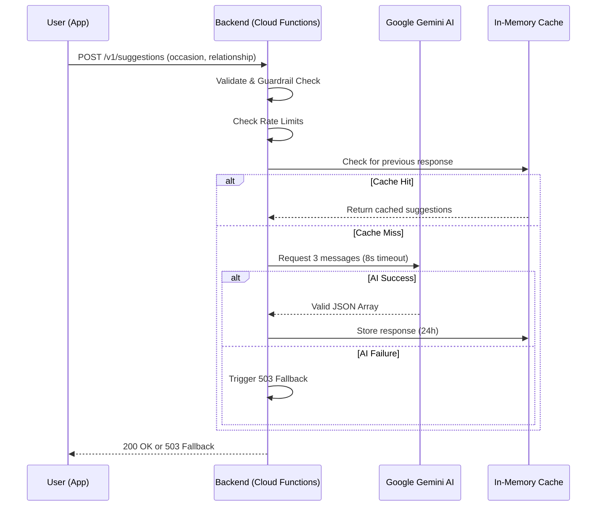

# AI Message Suggester — Technical Test

This project is a full-stack solution for an **AI-powered gift card message suggester**. It allows users to receive personalized message suggestions based on the occasion and their relationship with the recipient.

The project is structured as a monorepo containing two main submodules. This approach allows each repository to maintain its **independent CI/CD pipeline** while providing a unified entry point for teams to **clone and run the entire system quickly**.

- [**API (Backend)**](api/): Node.js 24 + Firebase Cloud Functions + Google Gemini AI.
- [**App (Frontend)**](app/): Flutter 3.38+ (Dart 3.x).

---

## 🏗️ Architecture Overview

The system follows a modern, decoupled architecture:

1. **Flutter App**: Handles user interaction and displays suggestions.
2. **Firebase Cloud Functions**: Acts as a secure gateway, providing rate limiting, validation, and LLM orchestration.
3. **Google Gemini AI**: Generates personalized messages using a strictly structured prompt.



For more details, see:

- [API Architecture](api/docs/ARCHITECTURE.md)
- [App Architecture](app/docs/ARCHITECTURE.md)

---

## 🚀 Getting Started

### Quick Setup (Recommended)

> [!NOTE]
> This repository uses **SSH** URLs for its submodules. Ensure you have your SSH keys properly configured with GitHub before cloning.

We provide scripts to automate environment configuration, dependency installation, and execution, with support for both Linux/macOS (`.sh`) and Windows (`.bat`).

```bash
# Clone the repo with submodules
git clone --recursive git@github.com:lucssilva/message-suggester.git
cd message-suggester

# Make Linux/macOS scripts executable
chmod +x scripts/*.sh scripts/common/*.sh
```

#### Run All (API & App together)

The easiest way to start both the Firebase Emulator (API) and the Flutter app is by running our combined script. It will automatically call the setup process first.

```bash
# Linux/macOS
./scripts/run_all.sh --api-key YOUR_GOOGLE_GEMINI_API_KEY

# Windows (Command Prompt)
scripts\run_all.bat --api-key YOUR_GOOGLE_GEMINI_API_KEY
```
*(Note: `--api-key` is only required on the first run to create the `.env` file. On subsequent runs, you can simply run `./scripts/run_all.sh` or `scripts\run_all.bat`)*

#### Setup Only

If you only want to install dependencies and configure the `.env` without immediately starting the application, you can call the local setup script directly:

```bash
# Linux/macOS
./scripts/local_setup.sh --api-key YOUR_GOOGLE_GEMINI_API_KEY

# Windows
scripts\local_setup.bat --api-key YOUR_GOOGLE_GEMINI_API_KEY
```

---

## 🛠️ Decisions & Trade-offs

The project prioritizes **Resilience**, **Security**, and **Efficiency**.

- **Error Handling (503 Fallback)**: Instead of leaking LLM errors, the backend returns a friendly fallback message when the AI service is unavailable or times out.
- **In-Memory Caching (Trade-off)**: Implemented 24h caching for unique key pairs (occasion + relationship) to reduce costs and latency. For production, this would be moved to Firestore/Redis.
- **Strict Prompting**: Enforces JSON output to avoid parsing errors.
- **Regex Guardrails**: Use regular expressions at the validation layer to block prompt injection without the cost of a secondary moderation API call.

Detailed ADRs (Architecture Decision Records) can be found in the [App ADR folder](app/docs/adr/README.md).

---

## 🤖 AI Assistant Usage

This project was developed through a high-level collaboration with AI assistants (Antigravity/Gemini), following a specific **Software Design Document (SDD)** philosophy.

### Philosophy: Agent-Optimized SDD

Instead of utilizing standard, verbose documentation or traditional `spec` folders with nested plans, we opted for a **PRD.md / ARCHITECTURE.md / RULES.md** structure at the root of each submodule. This focused on **token-efficient, human-friendly docs**. This approach ensures that AI agents can quickly parse the system's "Source of Truth" without blowing through context windows, maintaining high accuracy in implementation while remaining easily digestible for human developers.

### Collaboration Workflow

The project evolved from an initial structural foundation built with varied high-speed models to a more specialized assistance phase. This later focus ensured consistency across submodules, intent prediction, and the identification of logical gaps during implementation.

### Testing & Verification

AI was instrumental in:

- Generating unit tests for the backend fallback paths.
- Verifying the consistency of API contracts between the client and server.
- Maintaining clear "Agent Rules" inside submodules to guide future AI collaboration.

---
Developed by [Lucas Silva](https://github.com/lucssilva)
