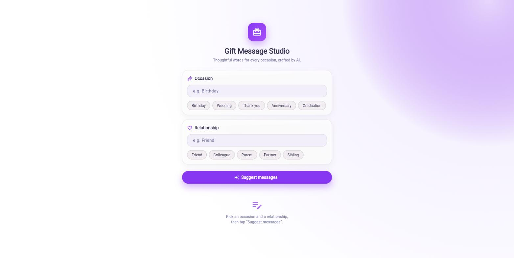
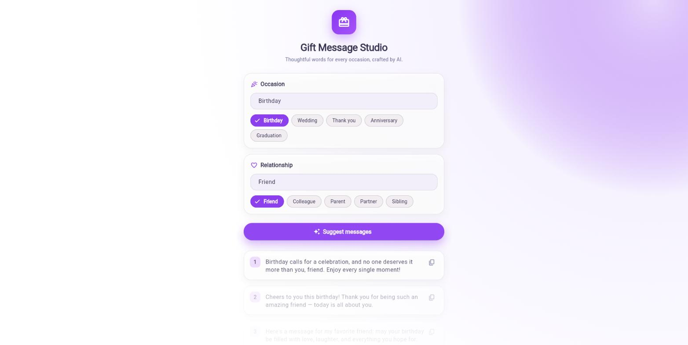
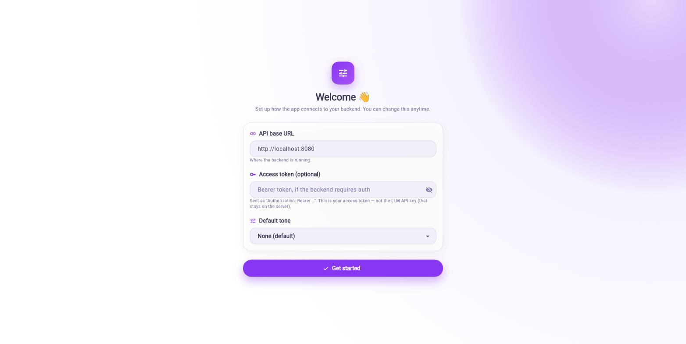
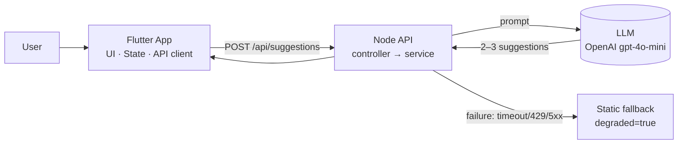

# AI-Powered Gift Card Message Suggester

Solution for the Senior Full Stack Developer technical test. The user picks an
**occasion** and a **relationship**; a Node.js/TypeScript API asks an LLM for
2–3 short gift-card messages; a Flutter app displays them with clear loading,
success and error states. When the LLM is unavailable, the backend **degrades
gracefully** to a safe static fallback instead of returning an error.

> The original test brief is preserved in [`docs/TEST_BRIEF.md`](docs/TEST_BRIEF.md).

---

## TL;DR — run it in 2 minutes (no API key needed)

```bash
# 1) Backend (runs in "fallback-only" mode without any key)
cd backend
npm install
npm run dev          # → http://localhost:8080

# 2) Flutter app (in another terminal)
cd flutter_app
flutter pub get
flutter run --dart-define=API_BASE_URL=http://localhost:8080
```

Pick **Birthday + Friend**, tap **Suggest messages**, and you'll see
suggestions. Without an LLM key these come from the deterministic fallback —
the full stack works end-to-end with zero external configuration. Add a key
later to get real AI output (see [Enabling the LLM](#enabling-the-llm-deferred)).

### Prefer Docker? Run the backend with one command

```bash
docker compose up --build      # → http://localhost:8080 (fallback mode)
```

The image is a multi-stage build (compiles TypeScript, then ships only the
compiled `dist/` and production deps, running as a non-root user with a
`HEALTHCHECK` on `/api/health`). It boots with zero configuration in
fallback-only mode. To enable the LLM, create `backend/.env` (it is loaded
automatically) or export `OPENAI_API_KEY` before running compose. Point the
Flutter app at the same `http://localhost:8080`. Stop it with
`docker compose down`. See [Running with Docker](#running-with-docker) for
details.

---

## Screenshots

| Home | Suggestions | First-run setup |
|------|-------------|-----------------|
|  |  |  |

Light, Smash-inspired UI (purple glow, pill controls, animated results) with a
first-run setup screen for the backend URL, access token, and default tone.

---

## Repository layout

```
.
├── backend/            # Node.js + TypeScript (Express) API
│   ├── src/functions.ts  # Same app exported as a Firebase Cloud Function
│   └── Dockerfile      # Multi-stage production image (non-root + healthcheck)
├── flutter_app/        # Flutter client (Material 3)
├── docker-compose.yml  # One-command backend run
├── firebase.json       # Emulator config (functions + firestore + auth)
├── firestore.rules     # Deny direct client access (server-side only)
├── .claude/            # Project agents & skills (Claude Code) — see below
├── assets/             # Flow diagram from the brief
└── docs/               # Original test brief
```

---

## Architecture



The layering is deliberate — each concern is isolated and independently
testable:

**Backend (`backend/src`)**

| Layer | Responsibility |
|-------|----------------|
| `routes/` | Compose dependencies, mount endpoints under `/api` |
| `controllers/` | HTTP boundary: validation (Zod), status codes. No business logic |
| `services/` | Resilience policy: cache → LLM → fallback |
| `llm/` | Vendor-agnostic `LlmProvider` interface + OpenAI impl + factory |
| `prompt/` | Prompt design, isolated from vendor code |
| `fallback/` | Deterministic offline suggestions |
| `middleware/` | Rate limiting + central error handler |

The service never lets a raw LLM error reach the client; the LLM layer is
swappable (OpenAI ↔ Gemini) by adding one provider and one `case`.

**Flutter (`flutter_app/lib`)**

`UI (screens/) → State (state/, ChangeNotifier + Provider) → API client
(services/) → Models (models/)`. The screen only reads from the controller;
the controller has no `BuildContext`; the API client only does HTTP. Base URL
is injected, so everything is unit/widget-testable without a real backend.

---

## API contract

### `POST /api/suggestions`

Request:
```json
{ "occasion": "Birthday", "relationship": "Friend", "tone": "heartfelt" }
```
`tone` is optional. `occasion` and `relationship` are required (1–80 chars).

Success `200`:
```json
{
  "suggestions": ["Happy birthday, dear friend! ...", "Wishing you ..."],
  "source": "llm",          // "llm" | "fallback" | "cache"
  "degraded": false          // true when the LLM failed and we fell back
}
```

Other responses:
- `400 invalid_request` — bad/missing input (with per-field details).
- `429 rate_limited` — rate limit exceeded (includes `Retry-After`).
- `500 internal_error` — only for truly unexpected errors; generic message.

`GET /api/health` → `{ "status": "ok" }`.

Note: an **LLM failure does not produce an HTTP error**. It returns `200` with
`source: "fallback"` and `degraded: true` — the client always has something to
show. See the reasoning below.

---

## Design decisions & trade-offs

### Error handling & fallback (the core of the exercise)

**What I treat as a failure:** LLM timeout (`LLM_TIMEOUT_MS`, default 8s),
HTTP `429`, HTTP `5xx`, and malformed/off-contract output (non-JSON, missing
array, fewer than 2 usable messages). All of these are normalized into a single
`LlmError` with a `kind`.

**How the client is affected:** on any of the above, the service logs full
detail *server-side* (via the logger) and returns the static fallback with
`degraded: true`. The client shows the messages plus a subtle "AI briefly
unavailable" banner. Rationale: for a gift-message helper, **a usable generic
message beats an error screen** — the feature keeps working. Raw errors, stack
traces and secrets never cross the HTTP boundary (there's a test asserting a
leaked-secret string never appears in the response).

**Fast-fail vs. graceful:** input validation *does* fail fast with `400` —
that's a client mistake, distinct from an upstream outage. Only upstream/LLM
problems are absorbed into the fallback.

### Rate limiting

Implemented: a dependency-free fixed-window limiter keyed by IP
(`RATE_LIMIT_MAX` per `RATE_LIMIT_WINDOW_MS`, default **30 req/min**). Over the
limit → `429` + `Retry-After`, no LLM call made. It protects the paid LLM from
bursts/abuse. Trade-off: in-memory and per-instance — fine for this test; in
production it belongs in a shared store (Redis) or the API gateway.

### Cost & caching

Implemented: an in-memory TTL cache keyed by `(occasion, relationship, tone)`
(`CACHE_TTL_MS`, default 5 min). Identical requests return `source: "cache"`
and skip the LLM entirely — the single biggest cost lever here, since the
input space is small and repetitive.

In production I would additionally: use a small/cheap model (already
`gpt-4o-mini`), cap `max_tokens` (done, 220), move the cache to Redis with a
longer TTL, and consider precomputing the top occasion×relationship
combinations offline. I kept the cache in-memory for the test to avoid an
external dependency.

### Prompt design

A firm system prompt pins role, count (2–3), length (1–2 sentences) and a JSON
output envelope, and instructs the model to treat the user fields as *topic
only* (a light guard against prompt injection through the inputs). Forcing JSON
(`response_format: json_object`) makes parsing deterministic — anything
off-contract becomes a fallback rather than garbage shown to the user.

### Express-first, Firebase-ready

The brief lists Firebase, but a deployed URL isn't required. I built the backend
as a plain Express app so it runs locally with zero cloud setup, and structured
it (`createApp()` exported separately from the server bootstrap) so the **same
app is wrapped, unchanged, in a Firebase Cloud Function**. That Function path
adds the Firebase-native pieces — **Firestore-backed cache** and **Firebase
Auth** — and runs entirely on the Local Emulator Suite (no billing). See
[Firebase](#firebase-cloud-functions--firestore--auth). The LLM key remains
optional (see below).

---

## Enabling the LLM (deferred)

By design the stack runs without any credentials. To enable real AI output:

```bash
cd backend
cp .env.example .env
# then set in .env:
#   OPENAI_API_KEY=sk-...
#   OPENAI_MODEL=gpt-4o-mini
npm run dev
```

`isLlmConfigured()` flips the service from fallback-only to live-LLM the moment
a key is present — no code change. Switching to Google AI (Gemini) is a
`GeminiProvider` implementing `LlmProvider` plus one `case` in
`llm/llm.factory.ts`; the `.env.example` already has the placeholders.

### Exercising the LLM path without a key (mock & Ollama)

You can run the real `source: "llm"` path (and caching) with **no key and no
cost**, in two ways — both a one-line config change, no code edits:

```bash
# 1) Built-in mock provider — varied, on-topic suggestions, zero dependencies.
LLM_PROVIDER=mock npm run dev

# 2) A local model via Ollama (OpenAI-compatible endpoint).
#    (ollama pull llama3.2, then:)
OPENAI_BASE_URL=http://localhost:11434/v1 \
  OPENAI_API_KEY=ollama OPENAI_MODEL=llama3.2 npm run dev
```

The `OPENAI_BASE_URL` override makes the client work with **any
OpenAI-compatible endpoint** (OpenAI, Azure, vLLM, LM Studio, Ollama). The mock
provider is ideal for demos and CI; Ollama gives real model output offline.

Note: **Firebase** is no longer deferred — the same app also runs as a Cloud
Function with Firestore + Auth on the emulator. See the next section.

---

## Firebase (Cloud Functions + Firestore + Auth)

The same Express app is also exported as a **Firebase HTTPS Cloud Function**
(`backend/src/functions.ts`), and on that path it is wired with the
Firebase-native pieces. Everything runs on the **Local Emulator Suite** — no
cloud project, account, or billing (only a `demo-` project id + Java, which the
emulators need).

- **Cloud Functions** — `onRequest(createApp(...))`. The exact same app and
  domain logic as the standalone server; nothing is forked.
- **Firestore** — a `FirestoreSuggestionCache` replaces the in-memory cache
  (injected via `createApp({ cache })`), so the cache is shared and survives
  cold starts. Direct client access is denied by `firestore.rules`; all access
  is server-side via the Admin SDK.
- **Firebase Auth** — the suggestions endpoint requires a valid ID token
  (`Authorization: Bearer <token>`), verified by the Admin SDK.

### Run it

```bash
cd backend
npm install
npm run firebase:emulators      # builds, then starts functions + firestore + auth
```

Emulator UI: http://127.0.0.1:4001 · Function base URL:
`http://127.0.0.1:5001/demo-gift-suggester/us-central1/api`

The Function uses `LLM_PROVIDER=mock` (via `backend/.env.demo-gift-suggester`),
so it exercises the full LLM path with **no key**. Smoke test:

```bash
FN=http://127.0.0.1:5001/demo-gift-suggester/us-central1/api/api/suggestions

# 401 without a token
curl -s -o /dev/null -w "%{http_code}\n" -X POST "$FN" \
  -H 'Content-Type: application/json' \
  -d '{"occasion":"Wedding","relationship":"Colleague"}'

# mint an ID token from the Auth emulator, then call the function
TOKEN=$(curl -s -X POST \
  "http://127.0.0.1:9099/identitytoolkit.googleapis.com/v1/accounts:signUp?key=fake" \
  -H 'Content-Type: application/json' \
  -d '{"email":"t@example.com","password":"password123","returnSecureToken":true}' \
  | python3 -c "import sys,json;print(json.load(sys.stdin)['idToken'])")

curl -s -X POST "$FN" -H "Authorization: Bearer $TOKEN" \
  -H 'Content-Type: application/json' \
  -d '{"occasion":"Wedding","relationship":"Colleague"}'   # → source: "llm"
# run the same call again → source: "cache" (served from Firestore)
```

> Note: Firebase Functions reserve the `PORT` env key, so `backend/.env` keeps
> `PORT` commented (the standalone server defaults to 8080). The `main` field in
> `backend/package.json` points at `dist/functions.js` for the Functions loader;
> the standalone server and Docker start `dist/index.js` explicitly, so both
> paths coexist from one codebase.

---

## Running with Docker

The backend ships a production-style container so it runs identically anywhere,
with no local Node toolchain required.

```bash
# from the repository root
docker compose up --build          # build image + start, → http://localhost:8080
docker compose logs -f backend     # follow logs
docker compose down                # stop and remove
```

**With an LLM key.** The compose service reads `backend/.env` automatically (if
present) and also passes through `OPENAI_API_KEY` from your shell:

```bash
OPENAI_API_KEY=sk-... docker compose up --build
```

**Image design (`backend/Dockerfile`):**

- **Multi-stage build** — a `build` stage installs all deps and runs `tsc`; the
  final `runtime` stage copies only `dist/` plus `npm ci --omit=dev`, so the
  shipped image carries no dev dependencies or source `.ts`.
- **Non-root** — runs as the built-in `node` user.
- **Healthcheck** — Docker probes `GET /api/health`; `docker compose ps` shows
  the container as `healthy` once the API is up.
- **Layer caching** — `package*.json` is copied and installed before the source,
  so code changes don't reinstall dependencies.

The container listens on `8080` internally; the host port is configurable via
`PORT` (e.g. `PORT=9000 docker compose up`). The Flutter base URL is unchanged
(`http://localhost:8080`, or your mapped port).

---

## Testing

**Backend** (Jest + supertest):
```bash
cd backend && npm run typecheck && npm run lint && npm test
```
Code style is enforced by **ESLint** (flat config, typescript-eslint) and
**Prettier**: `npm run lint` / `npm run format:check` (add `:fix` / `format` to
apply).
Covers the **fallback path** (timeout/429/5xx/invalid output → safe fallback,
priority), the happy path, caching, HTTP end-to-end with a mocked provider, a
no-leak assertion, LLM output parsing/error mapping, the **rate limiter** (429 +
`Retry-After`), the **mock provider**, and the **Firestore cache** (round-trip,
TTL, expiry).

**Flutter** (widget tests with a mocked HTTP client):
```bash
cd flutter_app && flutter analyze && flutter test
```
Covers the Birthday + Friend happy path end-to-end (UI → state → API), the
error state, input validation, and the **settings setup/persistence flow**.

**Continuous integration:** every push and pull request runs both suites via
GitHub Actions ([`.github/workflows/ci.yml`](.github/workflows/ci.yml)) — backend
`typecheck` + `lint` + `test`, and Flutter `analyze` + `test`.

---

## Base URL cheat-sheet (Flutter)

| Target | `API_BASE_URL` |
|--------|----------------|
| Chrome / desktop | `http://localhost:8080` |
| Android emulator | `http://10.0.2.2:8080` |
| Physical device  | `http://<your-LAN-IP>:8080` |

`API_BASE_URL` is the compile-time **default**; the in-app settings below can
override it at runtime without rebuilding.

---

## In-app settings (runtime configuration)

The app has a **setup screen** (`lib/screens/settings_screen.dart`) so users can
configure the client without editing code or rebuilding. It is shown
automatically on **first launch** and reachable anytime via the **gear icon** on
the main screen. Fields come **pre-filled** from saved values (or defaults) and
are freely editable; values persist across launches via `shared_preferences`.

| Setting | Purpose |
|---------|---------|
| **API base URL** | Backend address. Pre-filled with the `API_BASE_URL` default; overrides it at runtime. |
| **Access token** | Optional Bearer token, sent as `Authorization: Bearer <token>` — for the Firebase-Auth-protected backend. This is the *user's* access token. |
| **Default tone** | Optional tone (heartfelt, funny, …) applied to requests when none is picked. |

> **Security:** the **LLM API key is intentionally NOT configurable in the app** —
> it is a server-side secret and would be exposed if held in a client. The token
> field above is a user access token, not the LLM key. The client applies these
> settings before each request (`SuggestionController` → `SuggestionApi.configure`)
> and surfaces `401/403` as a clear "add a valid access token" message.

---

## Claude Code agents & skills

This repo ships project-scoped automation under `.claude/`:

- **Agents:** `backend-node-expert`, `flutter-expert` — scoped experts that know
  the layering and conventions of each side.
- **Skills:** `backend-dev`, `backend-test`, `flutter-run`, `flutter-test` —
  one-command run/test workflows.

---

## AI usage transparency

I used **Claude Code (Anthropic)** as a pair-programming assistant to scaffold
the project, write boilerplate, and draft this documentation. The engineering
decisions are mine and are the ones described above, specifically:

- the **resilience contract** (LLM failures return `200` + fallback + `degraded`
  rather than an HTTP error; validation still fails fast with `400`);
- the **vendor-agnostic LLM layer** so OpenAI/Gemini are swappable;
- the **layered structure** on both backend and Flutter for testability;
- the choice to run **Express locally and also as a Firebase Cloud Function**
  (Firestore cache + Auth) from one codebase, all on the emulator so it runs
  with zero external setup; the LLM key stays optional;
- the **caching/rate-limiting** approach and the production notes above;
- the **containerization** (multi-stage, non-root, healthcheck) and the
  **lint/format** setup (ESLint flat config + Prettier), added to make the
  project reproducible and consistent.

I reviewed and ran everything: `npm test` (backend), `flutter analyze` /
`flutter test` (app), and a manual `curl` smoke test of the running API in
fallback-only mode.
