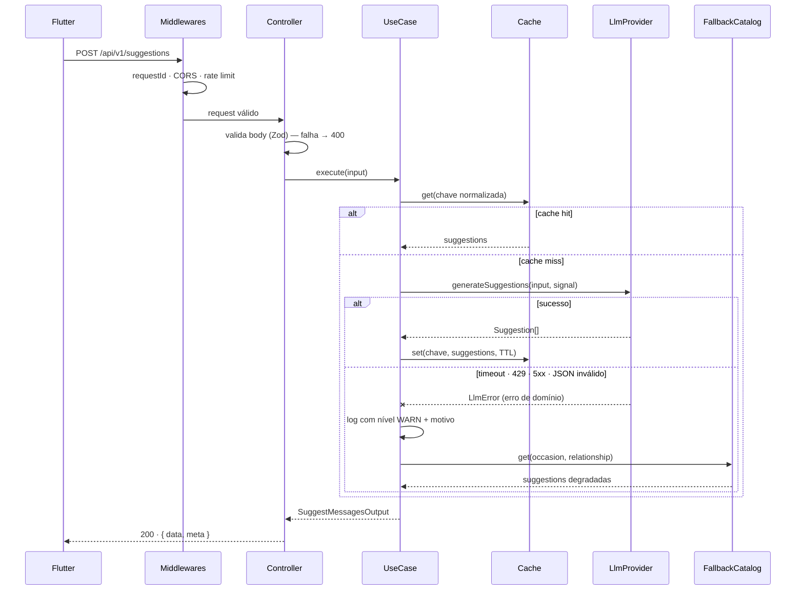

# Arquitetura do backend

**Stack:** Node.js 20 · TypeScript · Express · Zod · Vitest · Pino · Swagger UI

---

## Estrutura de pastas

```
backend/
├── src/
│   ├── domain/                        # Núcleo. Não importa NADA de fora.
│   │   ├── entities/
│   │   │   └── suggestion.ts
│   │   ├── dtos/
│   │   │   ├── suggest-messages-input.dto.ts
│   │   │   └── suggest-messages-output.dto.ts
│   │   ├── providers/
│   │   │   └── llm-provider.ts        # PORT
│   │   ├── repositories/
│   │   │   └── suggestion-cache.ts    # PORT
│   │   ├── services/
│   │   │   └── fallback-catalog.ts    # PORT
│   │   ├── usecases/
│   │   │   └── suggest-messages.usecase.ts
│   │   └── errors/
│   │       ├── domain-error.ts
│   │       ├── validation-error.ts
│   │       └── llm-errors.ts
│   │
│   ├── infra/                         # Implementa os ports do domain
│   │   ├── llm/
│   │   │   ├── openai/openai.provider.ts
│   │   │   ├── openrouter/openrouter.provider.ts
│   │   │   ├── gemini/gemini.provider.ts
│   │   │   ├── prompt/suggestion-prompt.ts
│   │   │   ├── parsing/llm-response.schema.ts
│   │   │   ├── security/input-sanitizer.ts       # camada 1
│   │   │   ├── security/output-guard.ts          # camada 3 ⭐
│   │   │   ├── security/canary.ts
│   │   │   └── llm-provider.factory.ts
│   │   ├── cache/in-memory-suggestion-cache.ts
│   │   ├── fallback/static-fallback-catalog.ts
│   │   └── http/fetch-http-client.ts
│   │
│   ├── presentation/
│   │   ├── controllers/suggestions.controller.ts
│   │   ├── validators/suggestions.schema.ts
│   │   ├── middlewares/
│   │   │   ├── cors.middleware.ts
│   │   │   ├── rate-limit.middleware.ts
│   │   │   ├── request-id.middleware.ts
│   │   │   └── error-handler.middleware.ts
│   │   ├── routes/v1/suggestions.routes.ts
│   │   └── docs/openapi.ts
│   │
│   ├── pkg/
│   │   ├── config/env.ts
│   │   ├── logger/logger.ts
│   │   ├── errors/app-error.ts
│   │   └── response/http-response.ts
│   │
│   └── main/
│       ├── app.ts                     # monta o Express
│       ├── container.ts               # composition root — a ÚNICA fábrica
│       └── server.ts                  # entrypoint + graceful shutdown
│
├── tests/
│   ├── unit/
│   └── integration/
├── .env.example
├── package.json
├── tsconfig.json
└── vitest.config.ts
```

---

## O contrato central: `LlmProvider`

Esta é a peça que faz o resto da arquitetura funcionar. Assinatura pretendida:

```ts
// src/domain/providers/llm-provider.ts
export interface LlmProvider {
  readonly name: string;
  readonly model: string;

  generateSuggestions(
    input: SuggestMessagesInput,
    signal: AbortSignal,
  ): Promise<Suggestion[]>;
}
```

Três decisões embutidas nessa assinatura, cada uma deliberada:

1. **Recebe `AbortSignal`.** O timeout é imposto por quem chama, não escondido dentro de
   cada adapter. Um adapter não consegue "esquecer" de respeitar o timeout.
2. **Devolve `Suggestion[]`, não texto cru.** Fazer parse e validar é responsabilidade do
   adapter — o use case nunca vê JSON de LLM. Se o modelo devolver lixo, o erro nasce ali
   e já é um erro de domínio.
3. **Lança erros de domínio, não erros de SDK.** `LlmTimeoutError`, `LlmRateLimitError`,
   `LlmUnavailableError`, `LlmInvalidResponseError`. O use case não sabe o que é um
   `APIError` da OpenAI — e não deveria saber.

---

## Fluxo de uma requisição



**Ponto a notar:** o `try/catch` em torno da chamada ao provider **nunca** é vazio nem
genérico. Ele classifica o erro, registra em log com o `requestId`, e decide o caminho
degradado. Regra do projeto: catch sem tratamento explícito não entra no código.

---

## Design do prompt

O prompt vive em `infra/llm/prompt/suggestion-prompt.ts`, isolado dos adapters. Os três
providers usam **o mesmo prompt**, o que torna a comparação entre modelos honesta.

Estratégia adotada:

- **System message** define papel, restrições de tamanho e o formato de saída.
- **Saída estruturada em JSON**, não texto livre — parsear prosa de LLM é fonte de bug.
  Onde o provider oferece *JSON mode* / *structured output*, ele é usado.
- **Restrições explícitas**: 1–2 frases por sugestão, sem nome de pessoa inventado, sem
  emoji por padrão, tom apropriado ao par `occasion` × `relationship`.
- **Temperatura moderada** — alta demais produz mensagem estranha; baixa demais produz
  as três sugestões quase idênticas, o que anula o propósito de pedir três.

A saída passa por um schema Zod (`llm-response.schema.ts`) antes de virar entidade.
Resposta que não passa no schema é tratada como **falha do LLM** e cai no fallback — não
é "consertada" no meio do caminho.

---

## Configuração

Toda leitura de `process.env` acontece em **um único arquivo**: `pkg/config/env.ts`,
validado com Zod na subida do processo. Se faltar variável obrigatória, o servidor
**não sobe** — falha barulhenta na inicialização é melhor que `undefined` silencioso em
produção às 3h da manhã.

Lista completa das variáveis: [`../04-operations/environment.md`](../04-operations/environment.md).

---

## Observabilidade

Log estruturado em JSON via Pino, com `requestId` propagado do middleware até o adapter.

| Evento | Nível | Por quê |
|---|---|---|
| Requisição recebida / respondida | `info` | Rastro básico |
| Falha do LLM com fallback servido | `warn` | Não é erro do sistema — o sistema reagiu como projetado |
| Erro inesperado (bug) | `error` | Precisa de ação humana |
| Prompt e resposta completos | `debug` | Só em desenvolvimento — pode conter dado do usuário |

**API key nunca é logada**, em nenhum nível.

---

## Segurança

O LLM é tratado como **dependência não-confiável nas duas direções**: pode falhar, e pode
produzir texto influenciado por quem digitou no formulário.

`infra/llm/security/` concentra as camadas 1 e 3 da defesa. A propriedade que torna isso
barato: **toda violação detectada vira `LlmInvalidResponseError`** e entra no mesmo funil
de fallback já construído — nenhum mecanismo novo de degradação foi necessário.

Detalhamento: [`../05-security/llm-security.md`](../05-security/llm-security.md)

## ADRs relacionados

- [`ADR-0001`](decisions/adr-0001-clean-architecture-backend.md) — por que Clean Architecture
- [`ADR-0002`](decisions/adr-0002-llm-provider-port-and-adapters.md) — port + três adapters
- [`ADR-0003`](decisions/adr-0003-fallback-strategy.md) — estratégia de fallback
- [`ADR-0004`](decisions/adr-0004-error-taxonomy.md) — taxonomia de erros
- [`ADR-0009`](decisions/adr-0009-llm-security.md) — segurança do LLM
- [`ADR-0010`](decisions/adr-0010-application-security.md) — baseline de segurança
