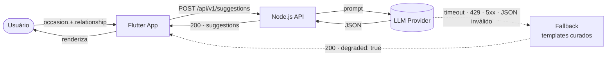
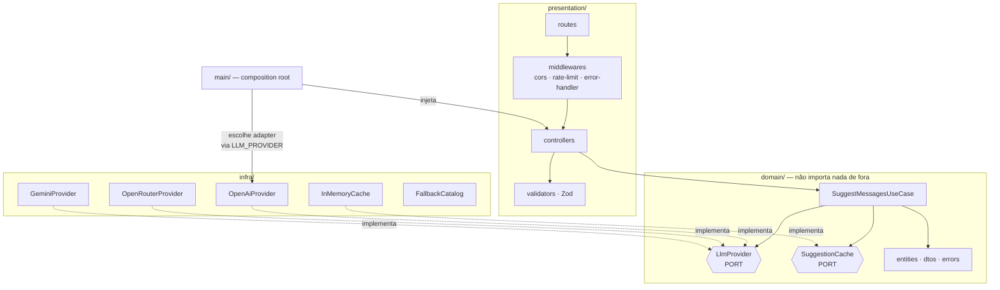
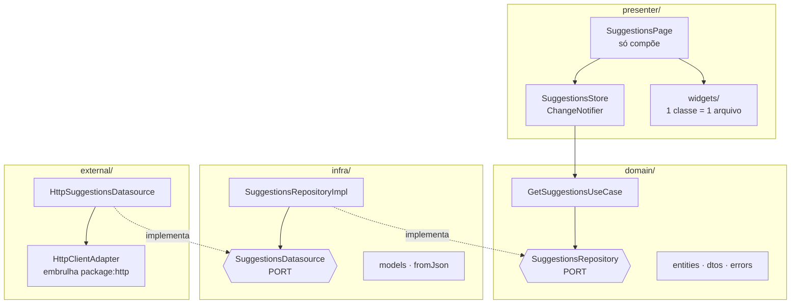

# Arquitetura — visão geral

## O problema, em uma frase

Receber `occasion` + `relationship`, pedir a um LLM 2–3 mensagens curtas de cartão-presente,
e **nunca deixar o usuário na mão** quando o LLM falhar.

A segunda metade dessa frase é onde mora a engenharia. Chamar uma API de LLM é trivial;
o que o teste avalia é o que acontece nos outros caminhos.

---

## Fluxo principal

A linha pontilhada é a razão de este teste existir. Ela **não devolve erro** — devolve
sugestões utilizáveis e um sinal honesto de que a qualidade caiu.

---

## Camadas do backend

**A regra que sustenta tudo:** a seta de dependência sempre aponta **para dentro**.
`domain/` não conhece Express, não conhece OpenAI, não conhece HTTP. Ele declara *portas*
(interfaces) e o `main/` decide quem as preenche.

O teste prático dessa regra: **trocar OpenAI por Gemini não toca em uma linha do use
case.** Se tocasse, a abstração estaria vazando.

---

## Camadas do Flutter

Fluxo de dependência: `External → Infra → Domain ← Presenter`.
A `Page` depende do `Store`; o `Store` depende do **use case**, nunca do cliente HTTP.

---

## Onde cada preocupação vive

| Preocupação | Backend | Flutter |
|---|---|---|
| Regra de negócio | `domain/usecases/` | `domain/usecases/` |
| Validação de entrada | `presentation/validators/` (Zod) | `presenter/controllers/` |
| Chamada externa | `infra/llm/*` | `external/datasources/` |
| Estado de tela | — | `presenter/controllers/` (ChangeNotifier) |
| Composição / DI | `main/` | `app/injector.dart` |
| Configuração | `pkg/config/` (`.env`) | `app/core/config/` (`--dart-define`) |

---

## Princípios SOLID, e onde cada um aparece de fato

Listar princípio sem apontar o arquivo é decoração. Cada linha abaixo é verificável.

| Princípio | Onde se manifesta |
|---|---|
| **S** — Responsabilidade única | O `SuggestMessagesUseCase` orquestra; ele não formata HTTP, não monta prompt e não faz parse de JSON. Cada uma dessas tarefas tem sua própria unidade. |
| **O** — Aberto/fechado | Adicionar um quarto provider de LLM = criar um arquivo em `infra/llm/` e registrá-lo na factory. Nenhum código existente é editado. |
| **L** — Substituição de Liskov | Os três adapters honram o mesmo contrato: mesma assinatura, mesmos erros de domínio. O use case não consegue distinguir qual está rodando. |
| **I** — Segregação de interface | `LlmProvider` e `SuggestionCache` são portas separadas e pequenas. Um cache não é obrigado a saber gerar texto. |
| **D** — Inversão de dependência | O use case depende da interface `LlmProvider`; quem instancia `OpenAiProvider` é o `main/`. O domínio nunca importa o SDK. |

---

---

## A segunda natureza do LLM

O diagrama acima trata o LLM como dependência que pode **cair**. Ele é também uma
**superfície de ataque**: o usuário controla texto que entra num prompt, e vê texto que sai
de um modelo.

A propriedade que define a estratégia de defesa é esta:

> **O LLM deste sistema não tem ferramenta nenhuma.**
> Não chama função, não lê banco, não acessa arquivo, não faz requisição de rede.

Logo, o pior caso de uma injeção bem-sucedida não é execução remota — é o modelo produzir
texto que nós exibimos como se fosse nosso produto. Isso desloca o peso da defesa da
**entrada** para a **saída**, porque filtrar entrada é estatística e validar saída é
garantia.

E o resultado se encaixa no que já existe: toda violação detectada vira
`LlmInvalidResponseError` e desce pela mesma linha pontilhada do primeiro diagrama.

→ [`../05-security/llm-security.md`](../05-security/llm-security.md)

---

## Detalhamento

- Backend: [`backend.md`](backend.md)
- Frontend: [`frontend.md`](frontend.md)
- Decisões arquiteturais (ADRs): [`decisions/`](decisions/)
- Segurança: [`../05-security/`](../05-security/)
