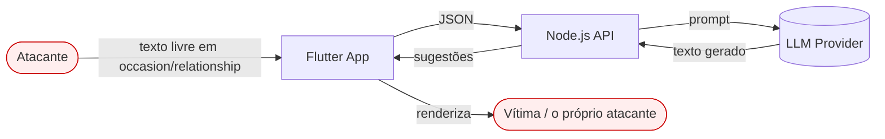

# Modelo de ameaça

Modelo de ameaça é a etapa que decide **onde vale investir defesa**. Sem ele, segurança
vira lista de boas práticas aplicadas no lugar errado.

---

## Superfície de ataque

**Entradas controladas pelo atacante:** `occasion`, `relationship`, `tone`, `language`,
`count`, mais os headers HTTP e o volume de requisições.

**Saídas que o atacante influencia:** o texto gerado pelo modelo, que o app renderiza.

### O que o sistema **não** expõe

Declarar o que não existe é parte do modelo — evita defender fronteira imaginária e
deixa explícito o que mudaria se essas condições mudassem.

| Ausência | Consequência |
|---|---|
| **Nenhuma ferramenta/tool no LLM** | Sem execução de código, sem chamada de função. Elimina LLM06 |
| **Nenhum banco de dados** | Sem SQL/NoSQL injection |
| **Nenhuma URL controlada pelo usuário** | Sem SSRF |
| **Nenhum RAG / base vetorial** | Elimina LLM08 |
| **Nenhum treinamento ou fine-tuning** | Elimina LLM04 |
| **Nenhuma autenticação, nenhum dado de usuário armazenado** | Sem sessão para roubar, sem privilégio para escalar |
| **Nenhum upload de arquivo** | Sem path traversal, sem malware |

---

## Agentes de ameaça

| Agente | Motivação | Capacidade |
|---|---|---|
| **Curioso** | Ver o system prompt, "quebrar" o brinquedo | Texto nos campos do formulário |
| **Abusador de custo** | Usar nossa key como LLM grátis, ou nos gerar prejuízo | Script batendo no endpoint |
| **Abusador de conteúdo** | Fazer o produto emitir texto ofensivo/impróprio e publicar o print | Prompt injection |
| **Atacante de terceiros** | Usar nossa saída como vetor (link de phishing dentro de "sugestão") | Prompt injection + engenharia social |
| **Operador do provider** | Ler o que trafega | Acesso ao serviço de LLM |

O **abusador de conteúdo** é o mais provável e o mais subestimado: não rouba nada, mas
produz o dano reputacional mais barato que existe — uma captura de tela do nosso produto
dizendo algo que não deveria.

---

## Ameaças, por risco

Impacto × probabilidade, no contexto **deste** sistema.

| # | Ameaça | OWASP LLM | Prob. | Impacto | Risco | Defesa principal |
|---|---|---|---|---|---|---|
| T1 | Injeção faz o modelo emitir texto arbitrário exibido como nosso produto | LLM01/LLM05 | Alta | Médio | **Alto** | Validação de saída |
| T2 | Vazamento do system prompt | LLM07/LLM02 | Média | Baixo | **Médio** | Canário + guard de saída |
| T3 | Abuso de custo / DoS econômico | LLM10 | Média | Médio | **Médio** | Rate limit + caps + cache |
| T4 | Saída com URL/HTML usada para phishing | LLM05 | Baixa | **Alto** | **Médio** | Guard de saída + render como texto puro |
| T5 | Dado pessoal do usuário indo para terceiro e para logs | LLM02 | Média | Médio | **Médio** | Política de log + aviso |
| T6 | Vazamento de API key | — | Baixa | **Crítico** | **Médio** | Key só no servidor + auditoria |
| T7 | Dependência comprometida | LLM03 | Baixa | Alto | **Baixo** | Lockfile + `npm audit` |
| T8 | Log injection (forja de linha de log) | — | Baixa | Baixo | **Baixo** | Sanitização antes de logar |
| T9 | Conteúdo gerado inadequado sem ataque nenhum | LLM09 | Baixa | Médio | **Baixo** | Prompt + guard + fallback |

### Por que T1 é o de maior risco, e não T2

Vazar o system prompt (T2) é constrangedor, mas o nosso system prompt **não contém
segredo** — é instrução de estilo para escrever mensagem de cartão. Quem o obtiver ganha
pouco.

Já T1 é diferente: **o atacante consegue que o nosso produto diga o que ele escreveu.**
Não precisa de acesso, não precisa de conta, e o resultado é publicável. É a ameaça que
mais justifica investimento aqui.

### Por que T4 tem impacto alto apesar da baixa probabilidade

Se uma "sugestão de mensagem" contiver `http://sitefalso.exemplo`, o link herda a
credibilidade do nosso produto. O usuário confia porque veio da nossa tela. É o cenário em
que a vítima não é quem atacou — e é por isso que o guard de saída rejeita URL, e-mail e
markdown de link **incondicionalmente**, mesmo que o modelo os tenha produzido por conta
própria.

---

## Fora de escopo, e por quê

| Fora de escopo | Motivo |
|---|---|
| Autenticação e autorização | Não existe conta neste produto |
| Criptografia de dados em repouso | Nada é persistido |
| Multi-tenancy / isolamento entre clientes | Não há tenant |
| Segurança física / de infraestrutura | Depende do alvo de deploy, ainda não decidido |
| Alinhamento e segurança do modelo em si | Responsabilidade do provider; nós tratamos a saída como não-confiável de qualquer forma |

A última linha é a postura que orienta o projeto: **a saída do LLM é entrada
não-confiável.** Não porque o provider seja ruim, mas porque parte dela é influenciável
por quem digita no formulário.

---

## Como este modelo vira código

| Ameaça | Onde é tratada |
|---|---|
| T1, T2, T9 | [`llm-security.md`](llm-security.md) — 4 camadas |
| T3 | [`ADR-0005`](../01-architecture/decisions/adr-0005-rate-limiting.md) + caps de tamanho |
| T4 | Guard de saída + regra de renderização no Flutter |
| T5 | Política de log em [`application-security.md`](application-security.md) |
| T6 | [`ADR-0002`](../01-architecture/decisions/adr-0002-llm-provider-port-and-adapters.md) + auditoria da fase 15 |
| T7, T8 | [`application-security.md`](application-security.md) |
