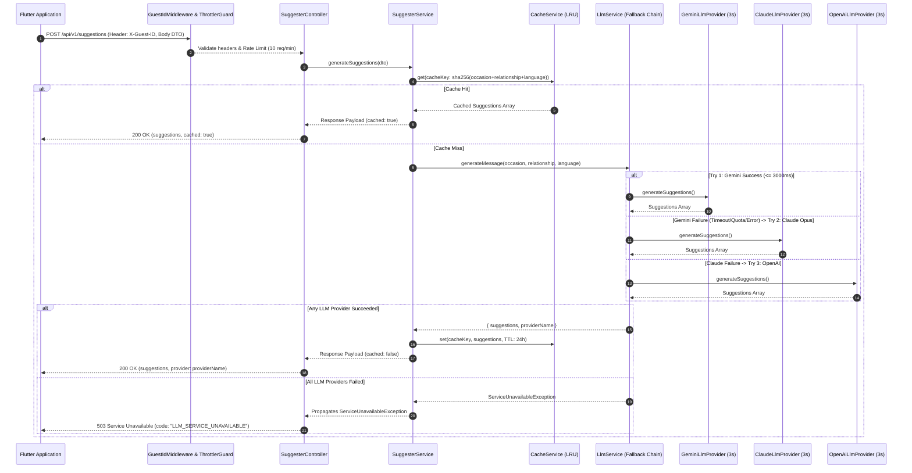

# Backend Architecture & Implementation Plan — NestJS

- **Framework**: NestJS (TypeScript / Node.js `v20+`)

---

## 📌 Architectural Overview

The backend service is designed as a resilient, modular RESTful API responsible for serving gift card message suggestions to the Flutter frontend application. It follows a **Clean Modular Architecture** using NestJS dependency injection, enforcing strict separation of concerns, strong type validation, LRU caching, rate limiting, and explicit error propagation (per [`RN04`](../specs/RN04-llm-failure-handling.md)).

---

## 🏗️ Module Directory Layout

```
server/
├── src/
│   ├── config/
│   │   ├── env.validation.ts       # Class-validator schema for environment variables
│   │   └── configuration.ts        # Typed configuration factory
│   ├── common/
│   │   ├── filters/
│   │   │   └── http-exception.filter.ts  # Standardized JSON error response formatter
│   │   ├── guards/
│   │   │   └── rate-limit.guard.guard.ts # Custom Throttler guard checking X-Guest-ID / IP
│   │   ├── interceptors/
│   │   │   └── logging.interceptor.ts    # Request/Response latency logging
│   │   └── middleware/
│   │       └── guest-id.middleware.ts    # X-Guest-ID header validation middleware
│   ├── modules/
│   │   ├── suggester/
│   │   │   ├── dto/
│   │   │   │   └── create-suggestion.dto.ts  # Input validation DTO
│   │   │   ├── suggester.controller.ts       # REST Endpoint (POST /api/v1/suggestions)
│   │   │   ├── suggester.service.ts          # Core business orchestration & cache lookup
│   │   │   └── suggester.module.ts           # Module metadata
│   │   ├── llm/
│   │   │   ├── interfaces/
│   │   │   │   └── llm-provider.interface.ts # Strategy Pattern Interface (ILlmProvider)
│   │   │   ├── providers/
│   │   │   │   └── gemini-llm.provider.ts    # Google Gemini API integration (@google/genai)
│   │   │   ├── llm.service.ts                # Provider wrapper & 4000ms timeout handling
│   │   │   └── llm.module.ts                 # Module metadata
│   │   └── cache/
│   │       ├── cache.service.ts              # In-memory LRU Cache service wrapper
│   │       └── cache.module.ts               # @nestjs/cache-manager registration
│   ├── app.module.ts                     # Main Application Root Module
│   └── main.ts                           # Server Bootstrap entry point
├── test/
│   ├── unit/                             # Service & Controller Unit Tests
│   └── e2e/                              # End-to-End API Integration Tests
├── Dockerfile
├── docker-compose.yml
└── package.json
```

---

## 🔄 Request Data Flow



---

## ⚙️ Core Architectural Components

### 1. Environment Variable Validation (`src/config/env.validation.ts`)
Uses `@nestjs/config` with `class-validator` to validate all environment variables during bootstrap. If required variables like `GEMINI_API_KEY` are missing, server startup halts immediately with a clear diagnostic message.

```typescript
export class EnvironmentVariables {
  @IsEnum(['development', 'production', 'test'])
  NODE_ENV: string = 'development';

  @IsNumber()
  PORT: number = 3000;

  @IsString()
  @IsNotEmpty()
  GEMINI_API_KEY: string;
}
```

### 2. Provider Strategy Pattern (`ILlmProvider`)
The `LlmModule` implements a decoupled Strategy Pattern via `ILlmProvider`. This allows replacing or mocking the LLM provider seamlessly in tests or future model upgrades without modifying the business logic layer.

### 3. Resiliency & Timeout Handling (RN04)
- **Timeout Enforcer**: LLM provider calls are wrapped in a 4000 ms timeout window using RxJS `timeout(4000)` or `Promise.race`.
- **Error Mapping**: When the LLM provider fails (timeout, rate limit, API error), `LlmService` throws a `ServiceUnavailableException`.
- **Global Exception Filter**: Intercepts `ServiceUnavailableException` and formats the standardized HTTP 503 JSON output specified in [`RN04`](../specs/RN04-llm-failure-handling.md).

### 4. Cache Engine & Key Hashing (`CacheModule`)
- **Engine**: In-Memory LRU Cache (`@nestjs/cache-manager`).
- **Retention**: 24 hours (86,400 seconds).
- **Key Generation Algorithm**: `sha256("${dto.occasion.trim().toLowerCase()}:${dto.relationship.trim().toLowerCase()}:${dto.language}")`.

### 5. Rate Limiting (`@nestjs/throttler`)
- **Limits**: Maximum 10 requests per 60-second window.
- **Key Identifier**: Prioritizes `X-Guest-ID` header; falls back to client IP address if `X-Guest-ID` is missing.

---

## 🧪 Testing Strategy

1. **Unit Testing (`npm run test`)**:
   - `SuggesterService`: Verifies cache hit vs cache miss execution paths.
   - `LlmService`: Verifies timeout enforcement (> 4000 ms) and exception conversion.
   - `CreateSuggestionDto`: Verifies input validation boundaries using `class-validator`.

2. **E2E Integration Testing (`npm run test:e2e`)**:
   - Mocks the LLM provider to test full HTTP request-response cycles.
   - Verifies 200 OK responses, 400 Bad Request validations, 429 Rate Limit enforcement, and 503 LLM failure responses.
