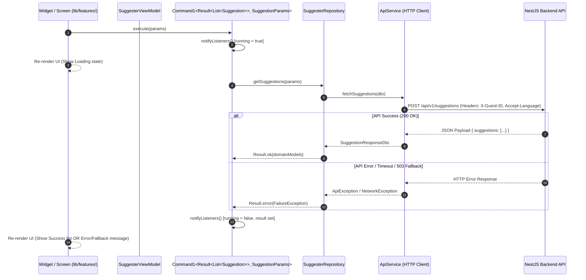

# Frontend Architecture — Flutter Application (MVVM + Command & Result)

This document specifies the official architecture, design patterns, directory organization, and data flow for the Flutter application located in [`application/`](../../application/).

The frontend application follows the **Official Flutter App Architecture Guidelines** recommended by Google ([docs.flutter.dev/app-architecture/guide](https://docs.flutter.dev/app-architecture/guide)), using **MVVM (Model-View-ViewModel)** with **Command & Result** patterns and **Feature-First Layered Organization**.

---

## 📌 Architectural Overview

The application is divided into three main layers: **UI & Feature Layer**, **Domain Layer**, and **Data Layer**, ensuring a clean separation of concerns, testability, and scalability.

```
                  ┌───────────────────────────────────────────────┐
                  │              UI & Feature Layer               │
                  │  ┌──────────────────┐    ┌─────────────────┐  │
                  │  │ Widgets / Screens│◄───┤    ViewModel    │  │
                  │  │ (lib/features/)  │───►│ (Command0/1)    │  │
                  │  └──────────────────┘    └────────┬────────┘  │
                  └───────────────────────────────────┼───────────┘
                                                      │ calls
                                                      ▼
                  ┌───────────────────────────────────────────────┐
                  │                 Domain Layer                  │
                  │        ┌─────────────────────────────┐        │
                  │        │        Domain Models        │        │
                  │        └─────────────────────────────┘        │
                  └───────────────────────────────────▲───────────┘
                                                      │ exposes domain data
                                                      │
                  ┌───────────────────────────────────┴───────────┐
                  │                  Data Layer                   │
                  │  ┌──────────────────┐    ┌─────────────────┐  │
                  │  │   Repositories   │───►│    Services     │  │
                  │  │ (Single Source)  │    │  (HTTP / Cache) │  │
                  │  └────────┬─────────┘    └─────────────────┘  │
                  │           │                                   │
                  │           ▼                                   │
                  │  ┌──────────────────┐                         │
                  │  │   Data Models    │                         │
                  │  │     (DTOs)       │                         │
                  │  └──────────────────┘                         │
                  └───────────────────────────────────────────────┘
```

---

## 🏗️ Directory Layout

The project structure strictly adheres to the feature-first and layer-separated hierarchy:

```
application/
├── lib/
│   ├── features/                     # Feature modules (e.g., suggester, guest_session)
│   │   └── <feature_name>/
│   │       ├── view_models/          # Feature ViewModels with Command0 / Command1
│   │       │   └── <view_model_class>.dart
│   │       └── widgets/              # Feature screens and feature-specific widgets
│   │           ├── <feature_name>_screen.dart
│   │           └── <other_widgets>.dart
│   ├── ui/
│   │   └── core/                     # Shared UI components & design system themes
│   │       ├── ui/                   # Shared UI widgets across features
│   │       │   └── <shared_widgets>.dart
│   │       └── themes/               # App themes, colors, gradients, typography
│   ├── domain/                       # Pure business entities & contracts
│   │   └── models/
│   │       └── <model_name>.dart
│   ├── data/                         # Data layer implementation
│   │   ├── repositories/             # Repository interfaces & concrete implementations
│   │   │   └── <repository_class>.dart
│   │   ├── services/                 # External services (ApiClient, LocalStorageService)
│   │   │   └── <service_class>.dart
│   │   └── model/                    # Data Transfer Objects (DTOs) with JSON serialization
│   │       └── <api_model_class>.dart
│   ├── config/                       # Application configuration & environment settings
│   ├── utils/                        # Architectural utilities (result.dart, command.dart)
│   ├── routing/                      # App navigation & route declarations
│   ├── main_staging.dart             # Staging environment entrypoint
│   ├── main_development.dart         # Development environment entrypoint
│   └── main.dart                     # Production environment entrypoint
├── test/                             # Unit & Widget tests mirroring lib/ structure
│   ├── data/
│   ├── domain/
│   ├── ui/
│   └── utils/
└── testing/                          # Test utilities & mock objects
    ├── fakes/                        # In-memory fakes for repositories & services
    └── models/                       # Test fixture factories and domain mocks
```

---

## 🔄 Data Flow Sequence

The sequence diagram below demonstrates an asynchronous operation (e.g., requesting AI message suggestions) using the **Command & Result** pattern.



---

## ⚙️ Core Architectural Patterns

### 1. ViewModel & Command Pattern (`Command0`, `Command1`)

ViewModels inherit from `ChangeNotifier` and expose `Command` objects instead of raw `Future` methods or complex state machines.

- **`Command0<T>`**: Represents an asynchronous action that takes **no parameters** (e.g., `refreshSessionCommand`).
- **`Command1<T, P>`**: Represents an asynchronous action that takes **one parameter** `P` (e.g., `generateSuggestionsCommand`).

#### Characteristics of Command:
- Encapsulates execution state: `running`, `completed`, `error`, `result`.
- Automatically calls `notifyListeners()` when execution starts, completes, or fails.
- Prevents duplicate concurrent executions when `running == true`.

#### Example Usage in ViewModel:

```dart
class SuggesterViewModel extends ChangeNotifier {
  final SuggesterRepository _repository;

  SuggesterViewModel({required SuggesterRepository repository})
      : _repository = repository {
    generateCommand = Command1(_generateSuggestions);
  }

  late final Command1<Result<List<Suggestion>>, SuggestionParams> generateCommand;

  Future<Result<List<Suggestion>>> _generateSuggestions(SuggestionParams params) async {
    return await _repository.getSuggestions(params);
  }
}
```

### 2. Functional Error Handling with `Result<T>`

The Data and Domain layers return `Result<T>` instead of throwing exceptions.

```dart
sealed class Result<T> {
  const Result();

  factory Result.ok(T value) = Ok<T>;
  factory Result.error(Exception error) = Error<T>;
}

final class Ok<T> extends Result<T> {
  final T value;
  const Ok(this.value);
}

final class Error<T> extends Result<T> {
  final Exception error;
  const Error(this.error);
}
```

This ensures compile-time safety and forces explicit handling of failure states (`Ok` vs `Error`) without unhandled runtime crashes.

---

## 📋 Implemented Business Rules Scoping

### 🌐 RN01 — Internationalization (`i18n`)
- Language selection (`pt-BR` / `en-US`) is managed centrally in `GuestSessionViewModel`.
- Automatically attaches the `Accept-Language` HTTP header via ApiClient interceptor.

### 👤 RN02 — Guest User Identifier (`GuestUser`)
- Anonymous session initialization with a persistent UUID v4 `guest_id`.
- ApiClient interceptor automatically injects `X-Guest-ID` header into every request sent to the NestJS backend.

### ⏱️ RN03 — 1-Week Session Cache Lifecycle
- `GuestUserRepository` verifies cache validity (7 days / 168 hours) at application startup.
- Expired sessions automatically regenerate a new `guest_id` and reset local history cache.

### 🛡️ RN04 — LLM Resiliency & User Feedback States
- ViewModels expose explicit UI states derived from `Command` execution:
  - **Loading**: `command.running == true`
  - **Success**: `command.result is Ok`
  - **Error / Fallback**: `command.result is Error` (Displays user-friendly message with retry capability).

---

## 🧪 Testing Guidelines

1. **Unit Testing (`test/domain/`, `test/data/`, `test/utils/`)**:
   - Verify `Command` state transitions (`running` -> `completed`).
   - Test `Repository` mapping from API DTOs to Domain Models and `Result` packaging.

2. **Widget Testing (`test/ui/`)**:
   - Test screen reactions to `Command.running`, `Ok`, and `Error` states using `ListenableBuilder`.

3. **Fakes & Mocks (`testing/fakes/`)**:
   - Use `FakeSuggesterRepository` and `FakeGuestUserRepository` for fast, reliable widget testing without network calls.
